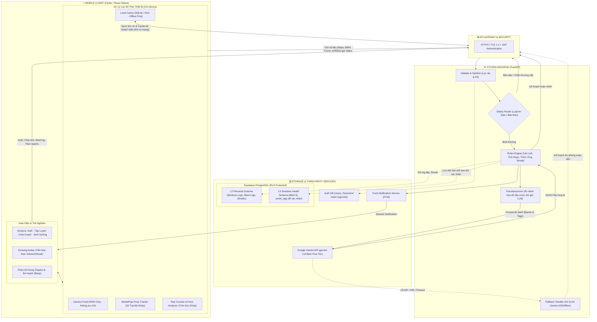
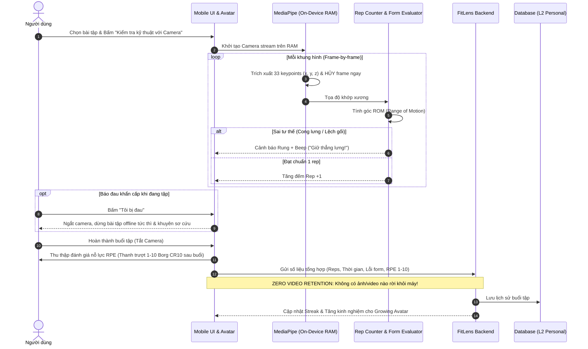
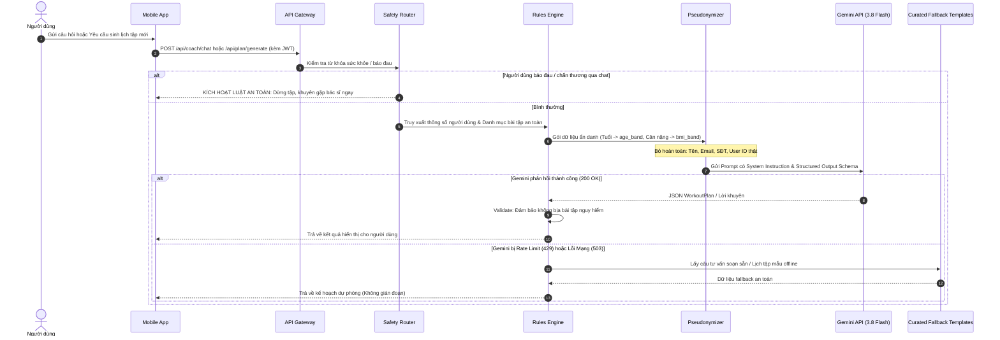

# FitLens — System Architecture Blueprint

> **Phiên bản:** 1.1 (Cập nhật chuẩn hóa CP1)  
> **Tác giả:** Nhóm 01 (CSC10014 — Computational Thinking)  
> **Phụ trách:** Gia Huy (Blueprint Kiến trúc + Repo)

---

> [!NOTE]
> **Minh định về trạng thái triển khai:**
> - **Hiện tại (Interactive UI Prototype & PoC):** Đã hiện thực hóa toàn bộ luồng tương tác của người dùng dưới dạng Web Prototype tương tác (`prototype/`) và PoC kết nối Gemini API (`poc/plan_generator/`) để kiểm chứng tính khả thi của giao diện và gợi ý kế hoạch. Module `setup-plan-model.js` trong thư mục này là mã JavaScript mô phỏng logic lọc bài tập ở client, chưa phải service backend hoàn chỉnh.
> - **Kiến trúc mục tiêu (Target Architecture):** Mô hình MediaPipe Pose chạy on-device native trên Flutter, backend FastAPI, Supabase PostgreSQL, SQLite cache offline-first và bộ quy tắc đối soát tĩnh (curated safety rules) là bản thiết kế hệ thống hoàn thiện cho giai đoạn MVP.

---

## 1. Sơ đồ các khối chính (System Block Diagram)

Hệ thống FitLens được thiết kế theo nguyên tắc **Offline-First**, **On-Device Vision** và **Phân lớp an toàn (4 Trust Zones)**.

---

## 2. Hai luồng dữ liệu chính (Two Core Data Flows)

### Luồng 1: Tập với Camera & Chốt Chặn Báo Đau (On-Demand Tracking & Safety Stop)
Tính năng camera là **On-Demand** (chỉ bật khi người dùng cần kiểm tra kỹ thuật động tác mới/khó), không ép bật liên tục. Nút *"Tôi bị đau"* luôn hiển thị nổi bật để dừng tập offline tức thì.

---

### Luồng 2: Hỏi Coach & Sinh Kế Hoạch Tập Luyện (Ask Coach & Plan Generation)
Luồng này thực hiện việc trò chuyện với PT ảo hoặc sinh lịch tập cá nhân hóa. Dinh dưỡng là module gợi ý bữa ăn độc lập theo mục tiêu và dị ứng, hoàn toàn không có cơ chế bù calo.

---

## 3. Cơ chế Router & Fallback (An Toàn & Khả Dụng)

### 3.1. Safety Router (Bảo vệ tính mạng & an toàn chấn thương)
FitLens là ứng dụng thể hình cho giới trẻ, **tuyệt đối không đưa ra chẩn đoán y tế sai lệch**:
1. **Phát hiện đau tức thì (Offline Pain Stop):**
   - Nút *"Tôi bị đau"* luôn hiển thị nổi bật trên màn hình tập luyện.
   - Khi bấm, app ngắt camera và dừng bài tập **ngay lập tức ở tầng Client** mà không cần kết nối internet.
   - Hiển thị khuyến nghị an toàn chuẩn mực: *"Dừng buổi tập ngay, chườm lạnh/nghỉ ngơi và đi khám chuyên khoa nếu cơn đau kéo dài"*.
2. **Quy trình ghi nhận phản hồi & Quản lý vùng cần tránh:**
   - Khi người dùng báo đau trong buổi tập hoặc chạm chọn vùng khó chịu trên bản đồ cơ thể sau buổi tập, hệ thống ghi nhận khó chịu tạm thời vào nhật ký buổi tập đó.
   - Người dùng có màn hình **chủ động xem xét và xác nhận/sửa các vùng cơ thể cần hạn chế vận động (`avoid_tags`)** cho các tuần sau (ví dụ: `avoid_tags: ["spinal_load", "high_impact"]`).
   - Hệ thống **không tự động biến một lần báo đau tức thời thành bệnh lý vĩnh viễn**. Rules Engine chỉ lọc bỏ bài tập khi người dùng xác nhận tình trạng cần tránh.

### 3.2. Cơ chế Thích Ứng (Adaptive Pacing) & Thống Nhất Thang RPE
Để giải quyết bài toán chống nản ngày đầu và tăng tiến bền vững (Progressive Overload):
1. **Thống nhất Thang Đo Cảm Nhận RPE (1–10 Borg CR10 sau buổi tập):**
   - RPE được thu thập **duy nhất một lần sau khi hoàn thành buổi tập**, không ngắt quãng người dùng sau từng hiệp.
   - Tách biệt rõ ràng: **RPE đo mức độ gắng sức thể lực (Exertion)**, hoàn toàn khác với **tín hiệu chấn thương (Pain Stop)**.
     - *1–3 (Light):* Vận động nhẹ nhàng, chưa mệt $\rightarrow$ Tăng +2 reps hoặc +5s giữ plank, giảm 10s nghỉ giữa hiệp.
     - *4–6 (Moderate):* Nỗ lực vừa sức, kiểm soát tốt $\rightarrow$ Giữ nguyên khối lượng để củng cố kỹ thuật.
     - *7–10 (Hard / All-out):* Nỗ lực rất cao, kiệt sức $\rightarrow$ Giảm 20–30% volume buổi sau để chống quá tải (Overtraining). **Mức 7–10 không tự động coi là chấn thương**.

2. **Dinh Dưỡng Độc Lập (Không Có Cơ Chế "Bù Calo"):**
   - Module dinh dưỡng đưa ra gợi ý bữa ăn sinh viên lành mạnh dựa trên mục tiêu thể trạng và dị ứng thực phẩm, độc lập với kế hoạch tập luyện.
   - Bỏ hoàn toàn cơ chế "ăn thêm thì phạt tập thêm hiệp" để xây dựng mối quan hệ lành mạnh với ăn uống và vận động.

3. **Quyền Riêng Tư & Xóa Dữ Liệu Cá Nhân (Right to be Forgotten):**
   - Tuân thủ Luật Bảo vệ Dữ liệu Cá nhân Việt Nam (NĐ 13/2023/NĐ-CP): Không thu thập GPS, danh bạ; camera chỉ chạy trên RAM (`Zero Video Retention`).
   - Cung cấp tính năng xóa tài khoản (`Delete Personal Data`) với cơ chế `ON DELETE CASCADE` xóa sạch profile và log lịch sử tập luyện khỏi server.

### 3.3. Fallback khi lỗi API (Resilience & Zero-Downtime)
Vì sử dụng tầng miễn phí **Google Gemini API Free Tier**, hiện tượng nghẽn (HTTP 429) hoặc gián đoạn dịch vụ có thể xảy ra:
- **Tầng 1 (Client Cache):** Lịch tập của tuần hiện tại luôn được cache cục bộ trong SQLite/Hive. Mất mạng người dùng vẫn mở app tập bình thường.
- **Tầng 2 (Exponential Backoff):** Adapter gọi Gemini được cấu hình retry tối đa 5 lần với thời gian chờ tăng dần (`initial_delay = 2s`).
- **Tầng 3 (Curated Knowledge Fallback):** Nếu retry thất bại hoặc Gemini quá tải, hệ thống tự động trả về câu trả lời từ bộ quy tắc đối soát tĩnh và mẫu bài tập soạn sẵn (`docs/reference/Note.md`) thay vì báo lỗi crash màn hình.

---

## 4. Công nghệ được chọn & Lý do (Tech Stack Justification)

| Thành phần | Công nghệ chọn | Lý do quyết định | Phương án dự phòng |
| :--- | :--- | :--- | :--- |
| **Mobile App** | **Flutter** (hoặc React Native) | • Viết 1 lần chạy cả iOS và Android. • Hỗ trợ truy cập camera native mượt mà. • Dễ dàng render UI động và nhân vật Growing Avatar. | React Native |
| **Pose Estimation** | **Google MediaPipe Pose** | • Chạy On-Device 100% trên RAM của điện thoại (Zero Video Retention). • Trích xuất chuẩn xác 33 keypoints 3D mà không tốn chi phí server GPU. | ML Kit Pose Detection |
| **Backend API** | **FastAPI (Python)** | • Tốc độ cao, asynchronous native. • Tích hợp mượt mà với SDK Gemini (`google-genai`) và Pydantic validation. • Viết ít code, nhẹ nhàng, triển khai nhanh. | Express.js (Node.js) |
| **Cơ sở dữ liệu** | **Supabase (PostgreSQL)** | • Free tier rộng rãi: 500 MB (chứa ~1.000 user-năm), 50.000 MAU. • Tích hợp sẵn Auth (hash mật khẩu an toàn) và Row-Level Security (RLS). | Turso (LibSQL/SQLite) |
| **Trí tuệ nhân tạo (LLM)** | **Google Gemini 3.8 Flash** | • Miễn phí 100% qua Google AI Studio. • Hỗ trợ Structured JSON Output với độ trễ thấp. • Phù hợp với tiêu chí đồ án 0đ. | Groq / OpenRouter Free |
| **Bộ nhớ cục bộ** | **SQLite / Hive** | • Hỗ trợ Offline-first, mở app lên là tập được ngay cả khi mất mạng. | Shared Preferences |

---

## 5. Kế hoạch hoàn thiện tiếp theo
- [x] Sơ đồ khối tổng quan & Sơ đồ luồng dữ liệu Mermaid.
- [x] Quy định Router an toàn khi đau & Fallback khi API lỗi.
- [x] Bảng công nghệ và cam kết bảo mật Zero Video Retention.
- [x] Chuyển hóa 3 nội dung trọng tâm thành slide báo cáo THA 20 phút.
