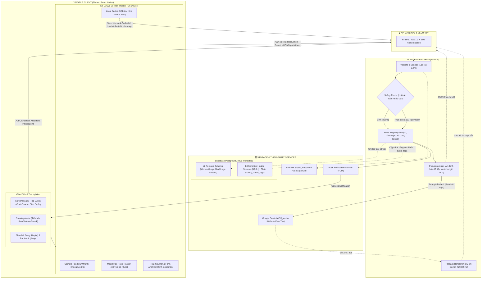
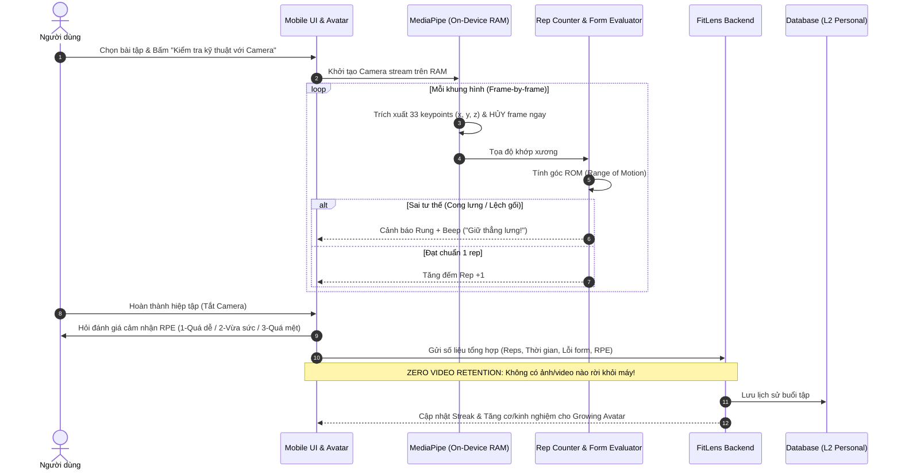
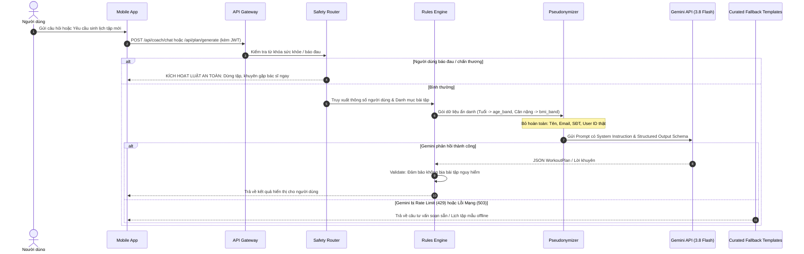

# FitLens — System Architecture Blueprint

> **Phiên bản:** 1.0 (Bản nháp CP1)  
> **Tác giả:** Nhóm 01 (CSC10014 — Computational Thinking)  
> **Phụ trách:** Gia Huy (Blueprint Kiến trúc + Repo)

---

## 1. Sơ đồ các khối chính (System Block Diagram)

Hệ thống FitLens được thiết kế theo nguyên tắc **Offline-First**, **On-Device Vision** và **Phân lớp an toàn (4 Trust Zones)**.

---

## 2. Hai luồng dữ liệu chính (Two Core Data Flows)

### Luồng 1: Tập với Camera (On-Demand Posture Tracking & Rep Counting)
Tính năng camera là **On-Demand** (chỉ bật khi người dùng cần kiểm tra kỹ thuật động tác mới/khó, quan hệ `«extend»` trong Use Case), không ép bật liên tục.

---

### Luồng 2: Hỏi Coach & Sinh Kế Hoạch Tập Luyện (Ask Coach & Plan Generation)
Luồng này thực hiện việc trò chuyện với PT ảo hoặc sinh lịch tập cá nhân hóa.

---

## 3. Cơ chế Router & Fallback (An Toàn & Khả Dụng)

### 3.1. Safety Router (Bảo vệ tính mạng & an toàn chấn thương)
FitLens là ứng dụng thể hình cho giới trẻ, **tuyệt đối không đưa ra chẩn đoán y tế sai lệch**:
1. **Phát hiện đau tức thì (Offline Pain Stop):**
   - Nút *"Tôi bị đau"* luôn hiển thị nổi bật trên màn hình tập luyện.
   - Khi bấm, app ngắt camera và dừng bài tập **ngay lập tức ở tầng Client** mà không cần kết nối internet.
   - Hiển thị khuyến nghị an toàn chuẩn mực: *"Dừng buổi tập ngay, chườm lạnh/nghỉ ngơi và đi khám chuyên khoa nếu cơn đau kéo dài"*.
2. **Gắn nhãn hạn chế (Condition Tagging):**
   - Khi phát hiện người dùng có vấn đề cột sống/khớp gối, hệ thống tự động gán nhãn `avoid_tags: ["spinal_load", "high_impact"]`.
   - Rules Engine sẽ tự động loại bỏ các bài như Barbell Squat, Deadlift, Jumping Jacks khỏi danh mục trước khi đề xuất cho người dùng.

### 3.2. Cơ chế Thích Ứng (Adaptive Pacing) & Đồng bộ thang RPE
Để giải quyết bài toán chống nản ngày đầu và tăng tiến bền vững (Progressive Overload):
1. **Đồng bộ Thang Đo Cảm Nhận RPE (UI 1–10 $\rightarrow$ Backend 3 Tầng):**
   - **Trên Giao diện Client (UI):** Sử dụng thanh trượt 1–10 theo chuẩn Borg CR10 để người dùng dễ kéo thả cảm nhận:
     - *1–3 (Light):* Vận động nhẹ nhàng, chưa mệt.
     - *4–6 (Moderate):* Nỗ lực vừa sức, kiểm soát tốt.
     - *7–10 (Hard / All-out):* Quá sức, kiệt sức, nhức mỏi.
   - **Xử lý tại Backend (Rules Engine):** Ánh xạ tự động 3 dải giá trị này để điều chỉnh giáo án tuần tiếp theo:
     - Dải 1–3 $\rightarrow$ Tăng +2 reps hoặc +5s giữ plank, giảm 10s nghỉ giữa hiệp.
     - Dải 4–6 $\rightarrow$ Giữ nguyên khối lượng để củng cố kỹ thuật thêm 1–2 buổi.
     - Dải 7–10 $\rightarrow$ Giảm 20–30% volume, tự động chuyển biến thể nhẹ hơn (vd: Barbell Squat $\rightarrow$ Goblet Squat / Chair Squat).

2. **Vòng Lặp Phản Hồi Chấn Thương (Injury Feedback Loop):**
   - Khi người dùng bấm *"Tôi bị đau"* hoặc chạm chọn vùng đau trên bản đồ cơ thể (*Body Map* ở màn hình Review), hệ thống tự động lưu vào bảng `health_conditions` (L3 Sensitive Health).
   - Bộ lọc `setup-plan-model` tự động thêm thẻ cấm (ví dụ: `avoid_tags: ["knees", "spinal_load"]`), lập tức **loại bỏ các bài tập gây áp lực lên vùng đó** khỏi lịch tập thích ứng tuần tiếp theo.

3. **Quyền Riêng Tư & Xóa Dữ Liệu Cá Nhân (Right to be Forgotten):**
   - Tuân thủ Luật Bảo vệ Dữ liệu Cá nhân Việt Nam (NĐ 13/2023/NĐ-CP): Không thu thập GPS, danh bạ; camera chỉ chạy trên RAM (`Zero Video Retention`).
   - Cung cấp tính năng xóa tài khoản (`Delete Personal Data`) với cơ chế `ON DELETE CASCADE` xóa sạch profile và log lịch sử tập luyện khỏi server.

### 3.3. Fallback khi lỗi API (Resilience & Zero-Downtime)
Vì sử dụng tầng miễn phí **Google Gemini API Free Tier**, hiện tượng nghẽn (HTTP 429) hoặc gián đoạn dịch vụ có thể xảy ra:
- **Tầng 1 (Client Cache):** Lịch tập của tuần hiện tại luôn được cache cục bộ trong SQLite/Hive. Mất mạng người dùng vẫn mở app tập bình thường.
- **Tầng 2 (Exponential Backoff):** Adapter gọi Gemini được cấu hình retry tối đa 5 lần với thời gian chờ tăng dần (`initial_delay = 2s`).
- **Tầng 3 (Curated Knowledge Fallback):** Nếu retry thất bại hoặc Gemini quá tải, hệ thống tự động trả về câu trả lời từ kho tri thức y khoa đối soát sẵn (`docs/reference/Note.md` / `medical_knowledge`) thay vì báo lỗi crash màn hình.

---

## 4. Công nghệ được chọn & Lý do (Tech Stack Justification)

| Thành phần | Công nghệ chọn | Lý do quyết định | Phương án dự phòng |
| :--- | :--- | :--- | :--- |
| **Mobile App** | **Flutter** (hoặc React Native) | • Viết 1 lần chạy cả iOS và Android. • Hỗ trợ truy cập camera native mượt mà. • Dễ dàng render UI động và nhân vật Growing Avatar. | React Native |
| **Pose Estimation** | **Google MediaPipe Pose** | • Chạy On-Device 100% trên RAM của điện thoại (Zero Video Retention). • Trích xuất chuẩn xác 33 keypoints 3D mà không tốn chi phí server GPU. | ML Kit Pose Detection |
| **Backend API** | **FastAPI (Python)** | • Tốc độ cao, asynchronous native. • Tích hợp mượt mà với SDK Gemini (`google-genai`) và Pydantic validation. • Viết ít code, nhẹ nhàng, triển khai nhanh. | Express.js (Node.js) |
| **Cơ sở dữ liệu** | **Supabase (PostgreSQL)** | • Free tier rộng rãi: 500 MB (chứa ~1.000 user-năm), 50.000 MAU. • Tích hợp sẵn Auth (hash mật khẩu an toàn) và Row-Level Security (RLS). | Turso (LibSQL/SQLite) |
| **Trí tuệ nhân tạo (LLM)** | **Google Gemini 3.8 Flash** | • Miễn phí 100% qua Google AI Studio. • Hỗ trợ Structured JSON Output với độ trễ thấp. • Phù hợp với tiêu chí đồ án 0đ. | Groq / OpenRouter Free |
| **Bộ nhớ cục bộ** | **SQLite / Hive** | • Hỗ trợ Offline-first, mở app lên là tập được ngay cả khi mất mạng. | Shared Preferences |

---

## 5. Kế hoạch hoàn thiện tiếp theo
- [x] Sơ đồ khối tổng quan & Sơ đồ luồng dữ liệu Mermaid.
- [x] Quy định Router an toàn khi đau & Fallback khi API lỗi.
- [x] Bảng công nghệ và cam kết bảo mật Zero Video Retention.
- [x] Chuyển hóa 3 nội dung trọng tâm thành slide báo cáo THA 20 phút.
