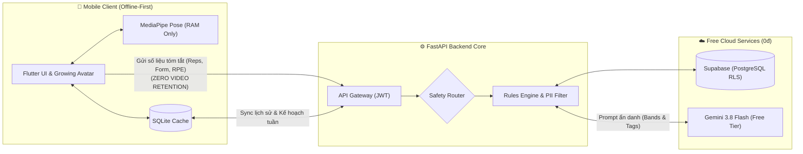
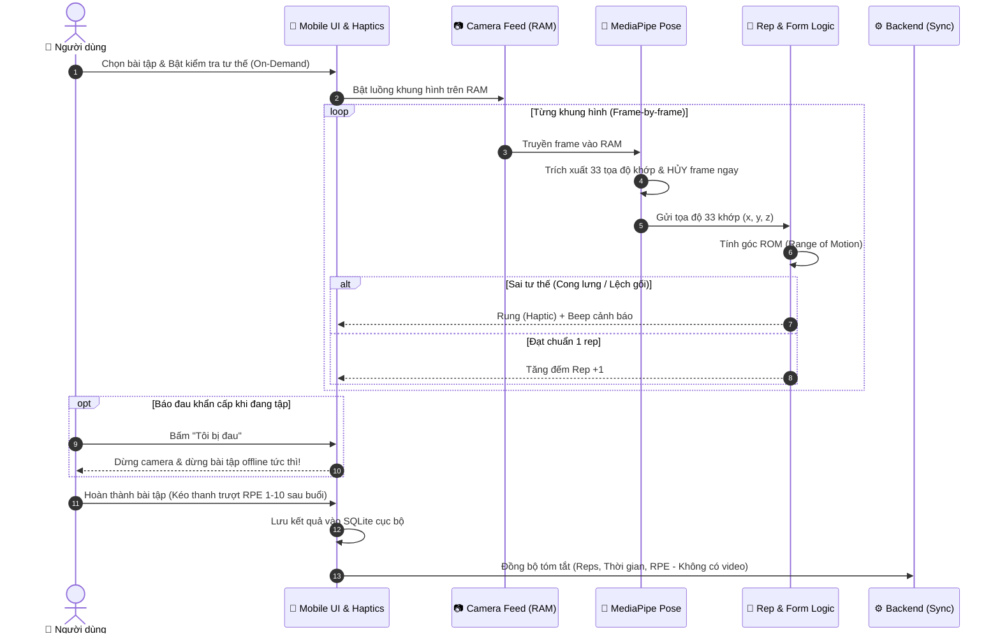
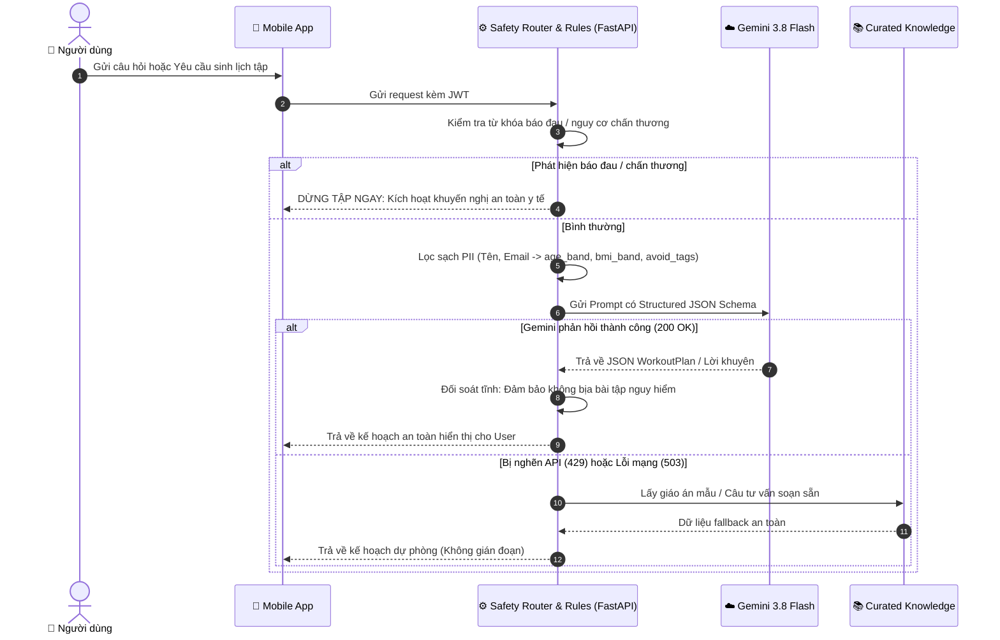

# FitLens — System Architecture (Bản Tinh Gọn)

> **Mục tiêu:** Bản kiến trúc cô đọng, trực quan, chia nhỏ luồng xử lý và lược bỏ chi tiết rườm rà để tiện đọc nhanh và thuyết trình.

---

> [!NOTE]
> **Trạng thái triển khai:**
> - **Đã có (Interactive UI Prototype):** Giao diện web mô phỏng đầy đủ luồng người dùng (`prototype/`) và PoC gọi Gemini API (`poc/plan_generator/`). Module `setup-plan-model.js` là mã JS mô phỏng logic UI, chưa phải backend production.
> - **Kiến trúc mục tiêu (Target Architecture):** MediaPipe chạy on-device trên Flutter, backend FastAPI, Supabase DB và cache SQLite là thiết kế triển khai cho giai đoạn MVP.

---

## 1. Sơ Đồ Tổng Quan 3 Khối (High-Level Overview)

Kiến trúc FitLens phân tách rõ ràng giữa **xử lý cục bộ trên máy** và **dịch vụ đám mây miễn phí 0đ**.

---

## 2. Hai Luồng Xử Lý Chuyên Biệt (Split Diagrams)

### Luồng 1: Xử lý Camera, Đếm Rep & Báo Đau Tại Chỗ (On-Device Vision & Pain Stop)
*Hoạt động hoàn toàn trên RAM điện thoại — Camera chỉ bật khi người dùng yêu cầu (On-Demand).*

---

### Luồng 2: Hỏi Coach & Chốt Chặn An Toàn (AI Coach & Safety Router)
*Bộ não phân luồng an toàn: Rules Engine kiểm soát sự thật, LLM chỉ đóng vai trò diễn ngôn. Dinh dưỡng là module độc lập không bù calo.*

---

## 3. Bốn Nguyên Tắc Cốt Lõi (Core Principles)

1. **Zero Video Retention (Bảo Mật Tuyệt Đối):**
   - MediaPipe Pose xử lý frame trực tiếp trên RAM điện thoại rồi hủy ngay.
   - Backend hoàn toàn **không có API nhận ảnh hay video**, loại bỏ 100% rủi ro lộ lọt hình ảnh nhạy cảm.

2. **Chốt Chặn Báo Đau & Quản Lý Vùng Cần Tránh:**
   - Nút *"Tôi bị đau"* dừng buổi tập ngay tại Client không cần mạng.
   - Phản hồi đau được ghi nhận tạm thời; người dùng **chủ động xem xét và xác nhận/sửa các vùng cần tránh** (`avoid_tags`) cho các buổi sau, hệ thống không tự động biến cơn đau tạm thời thành bệnh lý vĩnh viễn.

3. **Thống Nhất Thang RPE 1–10 (Tách Biệt Khỏi Chấn Thương):**
   - Thu thập duy nhất 1 lần sau buổi tập bằng thanh trượt Borg CR10 (1–10) để đo mức độ gắng sức thể lực (Exertion).
   - Mức 7–10 biểu thị nỗ lực cao / kiệt sức để giảm 20–30% volume tuần sau tránh quá tải (Overtraining), **không tự động coi là chấn thương**.

4. **Dinh Dưỡng Độc Lập (Không Có Cơ Chế "Bù Calo"):**
   - Gợi ý bữa ăn sinh viên dựa theo mục tiêu và dị ứng, hoàn toàn không phạt tập thêm hiệp khi ăn nhiều.

---

## 4. Bảng Công Nghệ Rút Gọn (Tech Stack Summary)

| Khối | Công nghệ | Ưu điểm cốt lõi | Chi phí |
| :--- | :--- | :--- | :---: |
| **Mobile App** | **Flutter** | 1 Codebase iOS & Android, offline SQLite, render Growing Avatar | **0đ** |
| **Computer Vision** | **Google MediaPipe Pose** | Chạy 100% on-device trên RAM, 33 khớp 3D, zero video retention | **0đ** |
| **Backend API** | **FastAPI (Python)** | Xử lý bất đồng bộ cực nhẹ, tích hợp chặt chẽ Pydantic validation | **0đ** |
| **Cơ sở dữ liệu** | **Supabase (PostgreSQL)** | Free Tier 500 MB (~1.000 user-năm), tích hợp sẵn Auth & RLS bảo mật | **0đ** |
| **AI Coach (LLM)** | **Gemini 3.8 Flash** | Tốc độ cao, JSON Schema chuẩn, hoàn toàn miễn phí qua AI Studio | **0đ** |
| **Bộ nhớ cục bộ** | **SQLite / Hive** | Hỗ trợ Offline-first, mở app tập ngay cả khi mất mạng | **0đ** |
