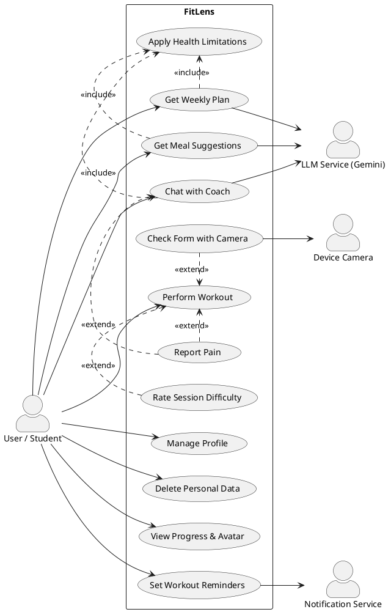

# FitLens — Use Case Diagram (cập nhật)

> **Phụ trách:** Đức Huy · **Mốc:** CP1 (CN 25/10/2026) · **Bản:** v2.1
> **Sửa từ:** bản use case cũ trong `docs/reference/report.md` (mục 3–4). *Cần xác nhận đây đúng là bản 13/10.*
> **Dựa trên:** [Function list F1–F7](FUNCTION_LIST.md) · **Kết quả kiểm tra:** [REVIEW_USE_CASES.md](REVIEW_USE_CASES.md)

## 1. Đối chiếu bản cũ → bản mới

| Bản cũ | Bản mới | Lý do |
|---|---|---|
| Plan Adaptive Workout | Get Weekly Plan | Đổi tên theo mục tiêu của người dùng |
| Customize by Health & Goal | Apply Health Limitations («include» dùng chung) | Lịch tập, bữa ăn và chat đều phải tránh vùng chấn thương, dị ứng |
| Progressively Scale Difficulty | Bước trong Get Weekly Plan | Bước trong luồng, không phải mục tiêu riêng |
| Suggest Nutrition & Balance Calories | Get Meal Suggestions | Bỏ phần bù calo (đã chốt 23/10: giống "trả nợ calo") |
| Consult Fitness Safety | Chat with Coach | Chat hỏi đáp chung; phần an toàn đi qua Report Pain |
| Query Medical RAG | Bỏ | Bước nội bộ |
| Trigger Doctor Referral | Report Pain | Gộp mọi chỗ người dùng báo đau vào một luồng an toàn |
| Perform Workout | Perform Workout | Giữ |
| Save Workout Session | Bước cuối của Perform Workout | Bước trong luồng |
| Check Posture with Camera | Check Form with Camera | Giữ, đổi tên |
| Check Space & Distance · Track 33-Joint Posture · Emit Form Warning | Các bước trong Check Form with Camera | Bước trong luồng |
| Provide Difficulty Feedback (RPE) | Rate Session Difficulty | Giữ, đổi tên |
| View Workout Heatmap · View Cumulative Heatmap & Streak | Bỏ heat map; streak chuyển sang View Progress & Avatar | Nhóm quyết định bỏ heat map |
| View Progress Dashboard | View Progress & Avatar | Thêm nhân vật mạnh lên theo buổi tập (quyết định 22/10) |
| Manage Personal Privacy · Delete Personal Data | Delete Personal Data | Gộp |
| — | Manage Profile · Set Workout Reminders | Mới, khớp F1 và F7 |

## 2. Tác nhân (Actors)

| Actor | Loại | Vai trò |
|---|---|---|
| **User / Student** | Primary (trái) | Sinh viên, người trẻ dùng app để tập |
| **Device Camera** | Secondary (phải) | Camera điện thoại, chỉ bật khi người dùng kiểm tra form |
| **LLM Service (Gemini)** | Secondary (phải) | API bên ngoài: sinh lịch tập, gợi ý bữa ăn, trả lời chat |
| **Notification Service** | Secondary (phải) | Dịch vụ thông báo đẩy (FCM) gửi nhắc lịch |

**Khác với quy ước cũ ở `docs/reference/Note.md` (cần nhóm xác nhận):**
- **Bỏ `Medical RAG Database`:** kho kiến thức là dữ liệu của chính FitLens (bảng `MedicalKnowledge`), không phải hệ thống bên ngoài.
- **`Camera / Pose Tracker` → `Device Camera`:** việc nhận dạng tư thế chạy trong app, tức là bên trong hệ thống; chỉ camera là thiết bị bên ngoài.
- **Bỏ `Audio Alert System`:** âm thanh và rung chỉ là đầu ra của Check Form with Camera.

## 3. Danh sách use case (11 chính + 1 dùng chung, xếp theo ưu tiên)

| # | Use case | Quan hệ & tác nhân phụ | Chức năng | Ưu tiên |
|---|---|---|---|---|
| UC01 | Manage Profile | — | F1 | P0 |
| UC02 | Get Weekly Plan | «include» Apply Health Limitations · LLM Service | F2 | P0 |
| UC03 | Perform Workout | — | F3 | P0 |
| UC04 | Check Form with Camera | «extend» Perform Workout · Device Camera | F3 | P0 |
| UC05 | Report Pain | «extend» Perform Workout và Chat with Coach | F4 | P0 |
| UC06 | Rate Session Difficulty | «extend» Perform Workout | F2 | P0 |
| UC07 | Delete Personal Data | — | F1 | P0 |
| UC08 | Get Meal Suggestions | «include» Apply Health Limitations · LLM Service | F5 | P1 |
| UC09 | Chat with Coach | «include» Apply Health Limitations · LLM Service | F6 | P1 |
| UC10 | View Progress & Avatar | — | F7 | P1 |
| UC11 | Set Workout Reminders | Notification Service | F7 | P1 |
| INC | Apply Health Limitations | Được include bởi UC02, UC08, UC09 | F4, F5 | P0 |

## 4. Quy tắc chính trong từng use case

Các quy tắc dưới đây đúng với cả hai phương án của câu hỏi 1 (báo đau). Chỗ nào còn chờ nhóm chốt thì ghi rõ.

- **UC01 Manage Profile:** vùng chấn thương chọn từ danh sách vùng cơ thể (cổ tay, gối, lưng dưới, vai, cổ chân…) để bộ lọc đọc được; ô ghi chú tự do chỉ là phụ. Có thao tác "đã hết đau" để gỡ hạn chế.
- **UC02 Get Weekly Plan:** dùng độ mệt từ UC06 để tăng hoặc giảm độ khó. Khi LLM lỗi, dùng lịch mẫu (fallback trong blueprint).
- **UC03 Perform Workout:** nút "Tôi bị đau" luôn hiện. Kết thúc buổi thì lưu kết quả (rep, thời gian).
- **UC04 Check Form with Camera:** chỉ có ở các bài có luật kiểm tra form. Trước khi quét thì kiểm tra khoảng cách và ánh sáng; xử lý trên máy, không lưu video.
- **UC05 Report Pain:** chạy không cần mạng. Trong buổi tập thì dừng buổi; trong chat thì ngừng gợi ý bài. Khuyên đi khám nếu đau kéo dài. Việc gì xảy ra với các buổi sau: chờ câu hỏi 1.
- **UC06 Rate Session Difficulty:** thang Dễ / Vừa / Quá sức, không có lựa chọn "đau" (đau đi qua UC05). Người dùng bỏ qua thì giữ nguyên độ khó.
- **UC07 Delete Personal Data:** xoá cả thông tin chấn thương. Dữ liệu đã gửi Gemini không xoá được, nên chỉ gửi dữ liệu đã ẩn danh.
- **UC08 Get Meal Suggestions:** tránh món gây dị ứng, không tính calo chính xác. Không bù calo bằng tập thêm (đã chốt 23/10).
- **UC09 Chat with Coach:** lọc tên, số điện thoại… trong tin nhắn trước khi gửi Gemini. Nhắc tới đau hoặc chấn thương thì sang UC05.
- **UC10 View Progress & Avatar:** ngày nghỉ theo lịch hoặc do báo đau không làm mất streak. Chỉ số nhân vật tính bằng luật từ dữ liệu buổi tập.
- **UC11 Set Workout Reminders:** nội dung nhắc chung chung, không chứa thông tin sức khoẻ (vì hiện trên màn hình khoá). Tạm dừng nhắc khi người dùng đang nghỉ do đau.
- **INC Apply Health Limitations:** loại mọi bài dùng tới vùng chấn thương và món gây dị ứng. Chỉ kiểm tra được bằng code khi bài và món có nhãn: chờ câu hỏi 2.

## 5. Non-goals (không làm trong MVP)

1. **Không chẩn đoán hay tư vấn y tế**, không khuyên về thuốc, thực phẩm chức năng hay nhịn ăn.
2. **Không lưu hay gửi ảnh, video** từ camera lên server. Mọi xử lý hình ảnh chạy trên điện thoại.
3. **Không bật camera suốt buổi tập.** Camera chỉ bật khi người dùng chọn kiểm tra form.
4. **Không có heat map cơ bắp.**
5. **Nhân vật không thay đổi hình dáng cơ thể** (không to cơ, không gầy đi), chỉ mạnh lên bằng chỉ số, kỹ năng, trang bị.
6. **Không tính calo hay macro chính xác.** Bữa ăn chỉ ghi ở mức ước lượng.
7. **Không có tính năng mạng xã hội:** không bảng xếp hạng, không chia sẻ, không kết bạn.
8. **Không kết nối thiết bị đeo** (smartwatch, đo nhịp tim).
9. **Không làm bản web.**
10. **Không có thanh toán hay gói trả phí.**
11. **Không bù calo bằng tập thêm hiệp** sau bữa ăn nhiều calo (đã chốt 23/10: giống "trả nợ calo").

## 6. Sơ đồ PlantUML

**Quy ước UML (để không bị trừ điểm):**
- `«include»`: mũi tên đứt nét **từ use case gốc → use case được include** (luôn xảy ra). Chỉ dùng cho phần dùng chung của 2+ use case.
- `«extend»`: mũi tên đứt nét **từ use case mở rộng → use case gốc** (chỉ xảy ra khi có điều kiện).
- Camera là `«extend»` của Perform Workout, không phải `«include»`, vì người dùng chỉ bật khi cần.

Render trên [PlantText](https://www.planttext.com) hoặc plugin PlantUML của draw.io / VS Code. Đây là nguồn duy nhất của sơ đồ: không vẽ lại bằng Mermaid, vì Mermaid chỉ vẽ ra flowchart.

