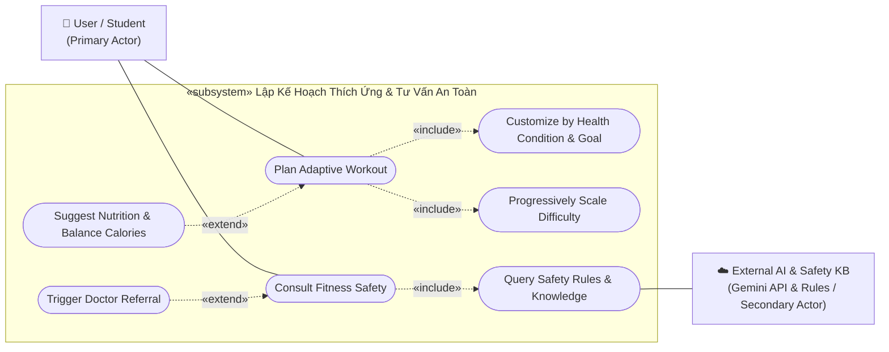
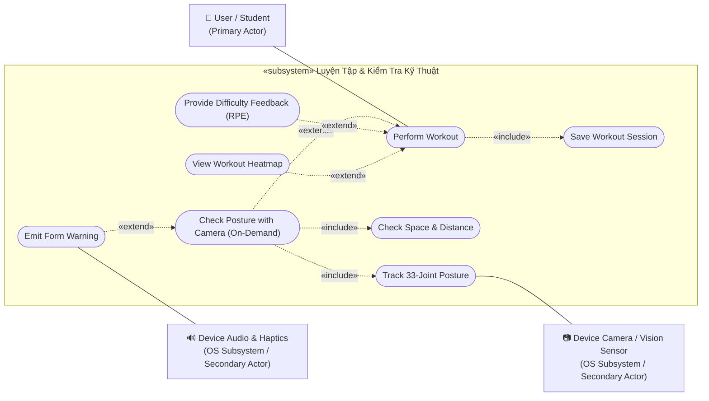
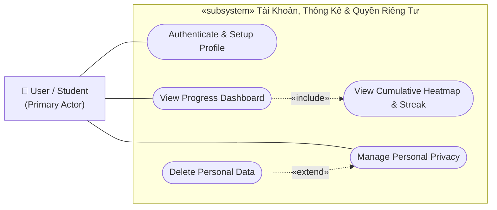
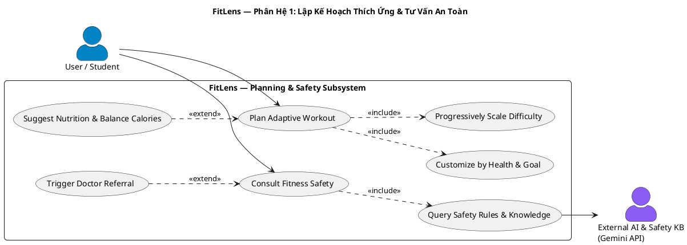
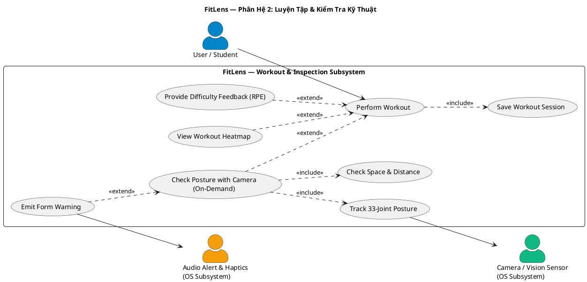
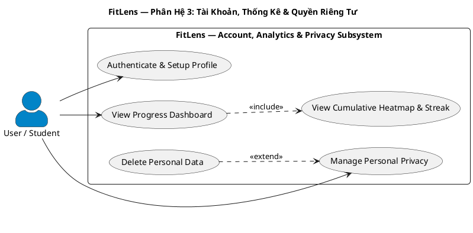

# FitLens — Sơ Đồ Ca Sử Dụng (Use Case Diagram) Chuẩn UML

> **Đồ án:** FitLens (AI Virtual Personal Trainer & Habit Coach)  
> **Môn học:** CS252 / CSC10014 — Computational Thinking (fit@hcmus)  
> **Nhóm thực hiện:** Group_01  
> **Tài liệu gửi THA:** Báo cáo phân tích thiết kế Use Case Diagram

---

## 1. Các Sơ Đồ Use Case Theo Phân Hệ (Mermaid UML)

Hệ thống FitLens được phân rã thành **3 phân hệ chức năng độc lập** nhằm tối ưu tính trực quan, loại bỏ bẫy quá tải chi tiết và bám sát kiến trúc phân lớp.

### 1.1. Phân Hệ 1: Lập Kế Hoạch Thích Ứng & Tư Vấn An Toàn (Planning & Safety)
Tập trung vào giải thuật thích ứng cường độ mượt mà (Progressive Overload), cá nhân hóa thể trạng và cơ chế chốt chặn an toàn y tế.

---

### 1.2. Phân Hệ 2: Luyện Tập & Kiểm Tra Kỹ Thuật (Workout & Form Inspection)
Tập trung vào luồng tập luyện thực tế, cơ chế camera On-Demand chạy 100% trên RAM (Zero Video Retention) và phản hồi rung/âm thanh sửa form.

---

### 1.3. Phân Hệ 3: Tài Khoản, Thống Kê & Quyền Riêng Tư (Account, Analytics & Privacy)
Tập trung vào quản lý danh tính, phân quyền dữ liệu và tuân thủ Luật Bảo vệ Dữ liệu Cá nhân (Nghị định 13/2023/NĐ-CP).

---

## 2. Mã Nguồn PlantUML (Chuẩn UML 2.5 Theo Từng Phân Hệ)

*Có thể copy từng đoạn mã dưới đây vào [PlantText](https://www.planttext.com/) hoặc tiện ích PlantUML để kết xuất riêng từng sơ đồ chất lượng cao.*

### 2.1. PlantUML — Phân Hệ 1: Lập Kế Hoạch & An Toàn

### 2.2. PlantUML — Phân Hệ 2: Luyện Tập & Kiểm Tra Kỹ Thuật

### 2.3. PlantUML — Phân Hệ 3: Tài Khoản, Thống Kê & Quyền Riêng Tư

---

## 3. Luận Điểm Thiết Kế & Biện Luận Chuẩn UML (Gửi THA)

Bản thiết kế này giải quyết triệt để các bẫy thường gặp trong Use Case Diagram nhằm bảo vệ điểm số:

### 1. Phân định ranh giới hệ thống (System Boundary) & Actor
- **Tại sao không có Actor "AI Engine"?**  
  Theo chuẩn UML, Actor bắt buộc phải là thực thể **bên ngoài** hệ thống phần mềm đang xây dựng. FitLens bản chất là một phần mềm tích hợp AI, do đó các mô hình thuật toán và Rules Engine nằm **bên trong** ranh giới hệ thống (`FitLens System`).
- **Các External Systems hợp lệ:**
  - `Camera / Vision Sensor`: Giao tiếp phần cứng camera qua API hệ điều hành thiết bị (OS Subsystem).
  - `Audio Alert & Haptics`: Hệ thống phản hồi âm thanh/rung của hệ điều hành.
  - `External AI & Safety KB`: Dịch vụ đám mây bên ngoài (Google Gemini API) và bộ quy chuẩn an toàn.

### 2. Chuẩn hóa ngữ nghĩa `«include»` vs `«extend»` (Tránh bẫy bắt bẻ UML)
- **`«include»` (Bắt buộc thực thi):**
  - Khi tập luyện (`Perform Workout`), phiên tập **bắt buộc** phải được lưu lại (`Save Workout Session`).
  - Khi lập lịch tập (`Plan Adaptive Workout`), hệ thống **bắt buộc** phải cá nhân hóa theo thể trạng (`Customize by Health & Goal`) và áp dụng tăng tiến (`Progressively Scale Difficulty`).
  - Khi xem tiến độ (`View Progress Dashboard`), hệ thống **bắt buộc** tính toán hiển thị heatmap tích lũy (`View Cumulative Heatmap & Streak`).
- **`«extend»` (Thực thi có điều kiện / Tùy chọn):**
  - **Camera On-Demand:** `Check Posture with Camera` mở rộng vào `Perform Workout` khi người dùng có nhu cầu kiểm tra form, không ép bật liên tục giúp tiết kiệm pin.
  - **Cảnh báo sai form:** `Emit Form Warning` mở rộng vào `Check Posture with Camera` và **chỉ kích hoạt khi phát hiện sai góc ROM**.
  - **Xóa tài khoản:** `Delete Personal Data` mở rộng vào `Manage Personal Privacy` và **chỉ kích hoạt khi người dùng xác nhận xóa vĩnh viễn** theo Nghị định 13/2023/NĐ-CP (tránh lỗi logic nếu dùng `«include»` sẽ biến mọi thao tác mở cài đặt thành xóa tài khoản).
  - **Chuyển tuyến y tế:** `Trigger Doctor Referral` chỉ mở rộng vào `Consult Fitness Safety` khi người dùng đề cập đến chấn thương cấp tính hoặc đau nhói.
  - **Gợi ý dinh dưỡng:** `Suggest Nutrition & Balance Calories` mở rộng vào `Plan Adaptive Workout` khi người dùng có nhu cầu kiểm soát calo bù trừ.

### 3. Ca sử dụng Xác thực (`Authenticate & Setup Profile`)
- Được đưa vào như một ca sử dụng nền tảng (`Base Use Case`) để giải quyết trọn vẹn luồng đăng nhập, bảo vệ dữ liệu cá nhân theo phân quyền trước khi thực hiện các nghiệp vụ theo dõi thể trạng.

---

## 4. Bảng Tóm Tắt Đặc Tả Các Ca Sử Dụng Trọng Tâm

| Mã UC | Tên Ca Sử Dụng | Tác Nhân | Loại Quan Hệ | Mô Tả Ý Nghĩa Nghiệp Vụ |
| :--- | :--- | :--- | :---: | :--- |
| **UC00** | `Authenticate & Setup Profile` | User | **Base** | Đăng nhập an toàn (Supabase Auth/JWT) & thiết lập chỉ số cá nhân ban đầu. |
| **UC01** | `Plan Adaptive Workout` | User | **Base** | Tự động sinh lịch tập tuần thích ứng theo thể trạng và mục tiêu. |
| **UC01.1**| `Customize by Health & Goal` | Hệ thống | `«include»` | Bắt buộc lọc bỏ các bài tập va chạm mạnh nếu có tiền sử đau cột sống/khớp gối. |
| **UC01.2**| `Progressively Scale Difficulty`| Hệ thống | `«include»` | Bắt buộc tăng tiến độ khó mượt mà dựa trên phản hồi (Progressive Overload). |
| **UC01.3**| `Suggest Nutrition & Balance Calories`| Hệ thống| `«extend»` | Tùy chọn gợi ý bữa ăn sinh viên và tính hiệp tập bù năng lượng thặng dư. |
| **UC02** | `Consult Fitness Safety` | User, ExternalAI | **Base** | Hỏi đáp kiến thức bài tập và bảo vệ khớp với HLV ảo. |
| **UC02.1**| `Query Safety Rules & Knowledge`| Hệ thống | `«include»` | Bắt buộc đối soát quy tắc an toàn y tế và template chuẩn trước khi phản hồi. |
| **UC02.2**| `Trigger Doctor Referral` | Hệ thống | `«extend»` | Kích hoạt cảnh báo dừng tập, khuyên đi khám khi phát hiện báo đau cấp tính. |
| **UC03** | `Perform Workout` | User | **Base** | Tiến hành buổi tập theo giáo án cá nhân hóa. |
| **UC03.1**| `Save Workout Session` | Hệ thống | `«include»` | Bắt buộc tự động lưu số hiệp, reps hoàn thành và thời gian vào SQLite. |
| **UC03.2**| `Check Posture with Camera` | User, PoseTracker | `«extend»` | Bật camera kiểm tra góc khớp khi người dùng có nhu cầu (On-Demand). |
| **UC03.3**| `Emit Form Warning` | AudioSys | `«extend»` | Phát âm thanh / rung cảnh báo khi phát hiện sai góc ROM. |
| **UC03.4**| `Provide Difficulty Feedback` | User | `«extend»` | Đánh giá độ mệt RPE (1–10) sau buổi tập để AI điều chỉnh buổi sau. |
| **UC03.5**| `View Workout Heatmap` | User | `«extend»` | Xem bản đồ nhiệt 2D cơ bắp được kích hoạt ngay sau buổi tập. |
| **UC04** | `View Progress Dashboard` | User | **Base** | Theo dõi chuỗi streak, tổng volume và bản đồ nhiệt tích lũy. |
| **UC04.1**| `View Cumulative Heatmap & Streak`| Hệ thống | `«include»` | Bắt buộc tính toán và kết xuất chuỗi streak cùng mật độ cơ kích hoạt. |
| **UC05** | `Manage Personal Privacy` | User | **Base** | Quản lý quyền riêng tư & bảo vệ dữ liệu cá nhân theo NĐ 13/2023/NĐ-CP. |
| **UC05.1**| `Delete Personal Data` | Hệ thống | `«extend»` | Thực hiện xóa sạch dữ liệu và tài khoản khi người dùng xác nhận yêu cầu. |
