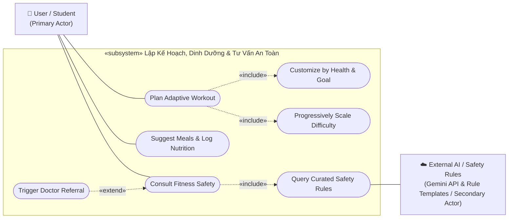
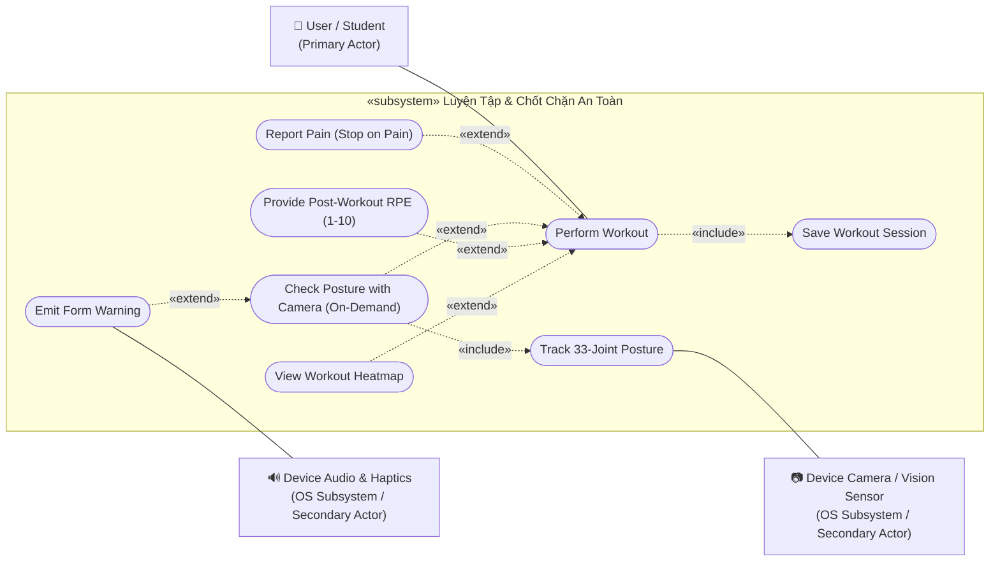
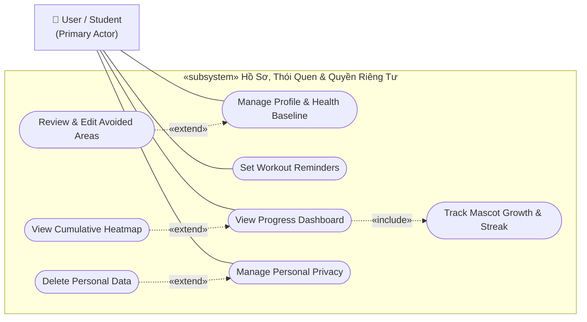
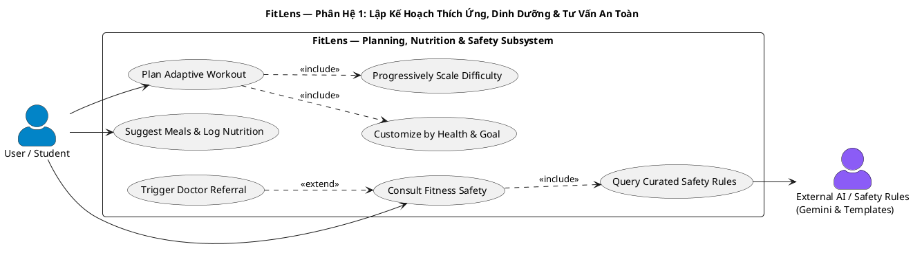
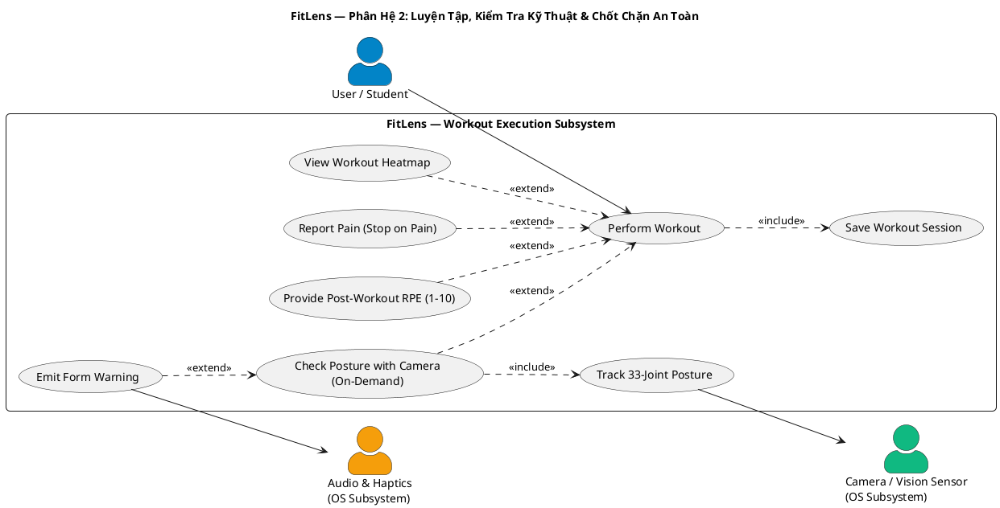
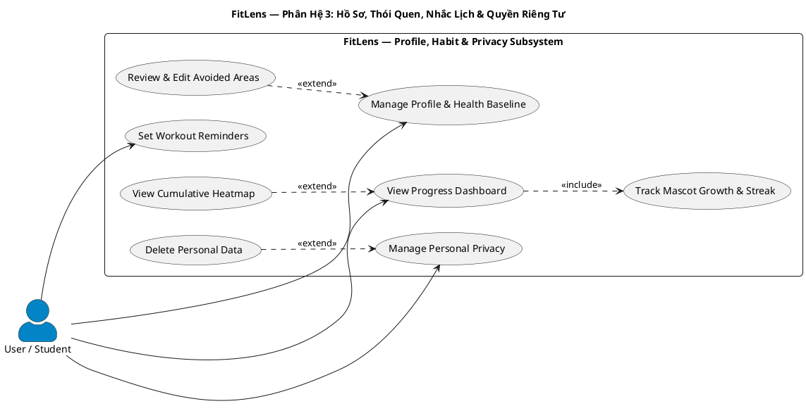

# FitLens — Sơ Đồ Ca Sử Dụng (Use Case Diagram) Chuẩn UML 2.5

> **Đồ án:** FitLens (AI Virtual Personal Trainer & Habit Coach)  
> **Môn học:** CS252 / CSC10014 — Computational Thinking (fit@hcmus)  
> **Nhóm thực hiện:** Group_01  
> **Tài liệu gửi THA:** Báo cáo phân tích thiết kế Use Case Diagram  
> **Phạm vi tài liệu:** Tập trung vào các ca sử dụng nghiệp vụ cốt lõi (**F1–F7**: Onboarding/Hồ sơ, Lập lịch tập thích ứng, Tập luyện & Báo đau, Đánh giá RPE sau buổi, Gợi ý & Ghi nhận bữa ăn, Nhắc nhở lịch tập, Thống kê chuỗi & Mascot). Các luồng mở rộng như Đi bộ (Steps) hay Recap tháng thuộc giai đoạn hoàn thiện giao diện mở rộng.

---

> [!NOTE]
> **Lưu ý về trạng thái triển khai:**
> - **Hiện tại (Interactive UI Prototype):** Các màn hình giao diện, luồng tương tác của người dùng (kể cả mascot, review RPE 1–10, chọn vùng đau, camera mockup) đã được hiện thực hóa trong thư mục `prototype/` và PoC gọi Gemini API trong `poc/plan_generator/`.
> - **Kiến trúc dự kiến (Target Architecture):** Tầng AI backend (FastAPI), nhận diện khớp on-device (MediaPipe Pose), bộ nhớ SQLite offline-first và Supabase DB là thiết kế kỹ thuật cho giai đoạn tiếp theo (MVP). Bộ quy tắc an toàn y tế là tập luật đối soát tĩnh (curated rules), không phải hệ thống CSDL Medical RAG phức tạp.

---

## 1. Các Sơ Đồ Use Case Theo 3 Phân Hệ (Mermaid UML)

### 1.1. Phân Hệ 1: Lập Kế Hoạch Thích Ứng, Dinh Dưỡng & Tư Vấn An Toàn (Planning & Safety)
*Lập kế hoạch thích ứng theo thể trạng/mục tiêu; dinh dưỡng độc lập theo nhu cầu và dị ứng thực phẩm (hoàn toàn không có cơ chế bù calo).*

---

### 1.2. Phân Hệ 2: Luyện Tập, Kiểm Tra Kỹ Thuật & Chốt Chặn Báo Đau (Workout Execution & Safety Guard)
*Buổi tập có nút khẩn cấp **"Tôi bị đau" (Stop on Pain)** ngắt tập tức thì; camera chỉ bật khi cần (On-Demand); đánh giá RPE (1–10) sau buổi tập hoàn toàn độc lập với chấn thương.*

---

### 1.3. Phân Hệ 3: Hồ Sơ, Thói Quen, Nhắc Lịch & Quyền Riêng Tư (Profile, Habit, Reminders & Privacy)
*Quản lý hồ sơ thể trạng; chủ động xem và sửa vùng cần tránh sau khi báo đau; theo dõi chuỗi tập và tiến hóa Mascot; tuân thủ Nghị định 13/2023/NĐ-CP.*

---

## 2. Mã Nguồn PlantUML (Chuẩn UML 2.5 Theo 3 Phân Hệ)

### 2.1. PlantUML — Phân Hệ 1: Lập Kế Hoạch, Dinh Dưỡng & Tư Vấn An Toàn

### 2.2. PlantUML — Phân Hệ 2: Luyện Tập & Chốt Chặn An Toàn

### 2.3. PlantUML — Phân Hệ 3: Hồ Sơ, Thói Quen, Nhắc Lịch & Quyền Riêng Tư

---

## 3. Luận Điểm Thiết Kế & Chuẩn Hóa Quan Hệ UML

1. **Loại bỏ triệt để quan hệ sai ý nghĩa:**
   - **Lập kế hoạch vs Dinh dưỡng:** Tách độc lập (`Suggest Meals & Log Nutrition` là ca sử dụng riêng). Ứng dụng gợi ý món ăn theo mục tiêu thể hình và dị ứng cá nhân, **không có cơ chế "bù calo"** (ăn thêm thì phạt tập thêm).
   - **Quản lý quyền riêng tư vs Xóa dữ liệu:** Quan hệ `«extend»`. Việc xóa tài khoản/dữ liệu theo NĐ 13/2023/NĐ-CP chỉ thực hiện khi người dùng chủ động yêu cầu và xác nhận, không phải mỗi lần vào cài đặt là xóa.
   - **Kiểm tra form vs Cảnh báo:** Quan hệ `«extend»`. Cảnh báo âm thanh/rung chỉ kích hoạt khi góc khớp vượt ngưỡng ROM an toàn.
   - **Dashboard vs Heatmap tích lũy:** Quan hệ `«extend»`. Mở Dashboard luôn xem được streak và mascot (`«include»`), còn bản đồ nhiệt tích lũy là màn hình chi tiết mở thêm khi cần.

2. **Chức năng an toàn cốt lõi: Nút "Tôi bị đau" (`Stop on Pain`):**
   - Đặt trực tiếp làm quan hệ `«extend»` vào ca sử dụng `Perform Workout`. Khi bấm nút, hệ thống lập tức ngắt camera và dừng phiên tập ở client mà không cần chờ mạng, sau đó hiển thị hướng dẫn sơ cứu.
   - Người dùng sau đó có thể chủ động xem và sửa vùng cần tránh (`Review & Edit Avoided Areas`), hệ thống **không tự động biến vùng đau tức thời thành bệnh lý vĩnh viễn**.

3. **Thống nhất thang RPE 1–10 sau buổi tập:**
   - Tách biệt rõ giữa **mức độ gắng sức (RPE)** và **tín hiệu chấn thương (Pain Stop)**.
   - RPE được thu thập **duy nhất 1 lần sau khi kết thúc buổi tập** qua thanh trượt Borg CR10 (1–10). Mức 7–10 biểu thị nỗ lực cao/kiệt sức để điều chỉnh giảm volume tuần sau, không tự động quy chụp là chấn thương.

---

## 4. Bảng Tóm Tắt Đặc Tả Các Ca Sử Dụng (F1–F7)

| Mã UC | Tên Ca Sử Dụng | Tác Nhân | Quan Hệ | Nghiệp Vụ Thực Tế |
| :--- | :--- | :--- | :---: | :--- |
| **UC01** | `Manage Profile & Health Baseline` | User | **Base** | Đăng ký/đăng nhập, nhập chiều cao, cân nặng, mục tiêu và tiền sử chấn thương. |
| **UC01.1**| `Review & Edit Avoided Areas` | User | `«extend»` | Xem và chủ động bật/tắt các vùng cơ thể cần hạn chế vận động cho tuần tới. |
| **UC02** | `Plan Adaptive Workout` | User | **Base** | Tạo lịch tập tuần thích ứng theo thể trạng cá nhân (Progressive Overload). |
| **UC02.1**| `Customize by Health & Goal` | Hệ thống | `«include»` | Lọc bỏ các bài tập va chạm mạnh dựa trên thẻ hạn chế vận động của người dùng. |
| **UC02.2**| `Progressively Scale Difficulty`| Hệ thống | `«include»` | Điều chỉnh số rep/hiệp mượt mà theo dữ liệu buổi trước để chống nản. |
| **UC03** | `Suggest Meals & Log Nutrition` | User | **Base** | Gợi ý bữa ăn sinh viên theo mục tiêu/dị ứng và ghi chép lại bữa ăn (không bù calo). |
| **UC04** | `Consult Fitness Safety` | User, ExternalAI | **Base** | Hỏi đáp kiến thức bài tập và an toàn khớp với HLV ảo. |
| **UC04.1**| `Query Curated Safety Rules` | Hệ thống | `«include»` | Đối soát quy chuẩn y tế và câu trả lời soạn sẵn trước khi phản hồi. |
| **UC04.2**| `Trigger Doctor Referral` | Hệ thống | `«extend»` | Kích hoạt cảnh báo dừng tập, khuyên đi khám khi phát hiện báo đau cấp tính qua chat. |
| **UC05** | `Perform Workout` | User | **Base** | Tiến hành buổi tập theo giáo án cá nhân hóa. |
| **UC05.1**| `Save Workout Session` | Hệ thống | `«include»` | Tự động lưu số hiệp, rep hoàn thành và thời gian vào SQLite. |
| **UC05.2**| `Report Pain (Stop on Pain)` | User | `«extend»` | Nút khẩn cấp ngắt camera và dừng bài tập ngay lập tức trên máy khi bị đau. |
| **UC05.3**| `Check Posture with Camera` | User, PoseTracker | `«extend»` | Tùy chọn bật camera kiểm tra góc khớp khi gặp bài tập mới (On-Demand). |
| **UC05.4**| `Emit Form Warning` | AudioSys | `«extend»` | Rung và phát tiếng beep cảnh báo khi phát hiện lệch góc ROM. |
| **UC05.5**| `Provide Post-Workout RPE (1-10)`| User | `«extend»` | Đánh giá cảm nhận độ mệt sau buổi tập bằng thang Borg CR10 (1–10). |
| **UC05.6**| `View Workout Heatmap` | User | `«extend»` | Xem bản đồ nhiệt 2D cơ bắp được kích hoạt ngay sau buổi tập. |
| **UC06** | `Set Workout Reminders` | User | **Base** | Đặt lịch nhắc tập luyện để duy trì kỷ luật và chuỗi ngày tập. |
| **UC07** | `View Progress Dashboard` | User | **Base** | Xem tổng quan chuỗi ngày tập (streak), tổng volume và tiến độ. |
| **UC07.1**| `Track Mascot Growth & Streak` | Hệ thống | `«include»` | Hiển thị nhân vật Mascot tiến hóa theo chuỗi ngày tập và khối lượng. |
| **UC07.2**| `View Cumulative Heatmap` | User | `«extend»` | Xem bản đồ nhiệt tích lũy theo tuần/tháng khi người dùng muốn phân tích sâu. |
| **UC08** | `Manage Personal Privacy` | User | **Base** | Quản lý quyền riêng tư theo Nghị định 13/2023/NĐ-CP. |
| **UC08.1**| `Delete Personal Data` | Hệ thống | `«extend»` | Xóa sạch tài khoản và lịch sử cá nhân khi người dùng xác nhận yêu cầu. |
