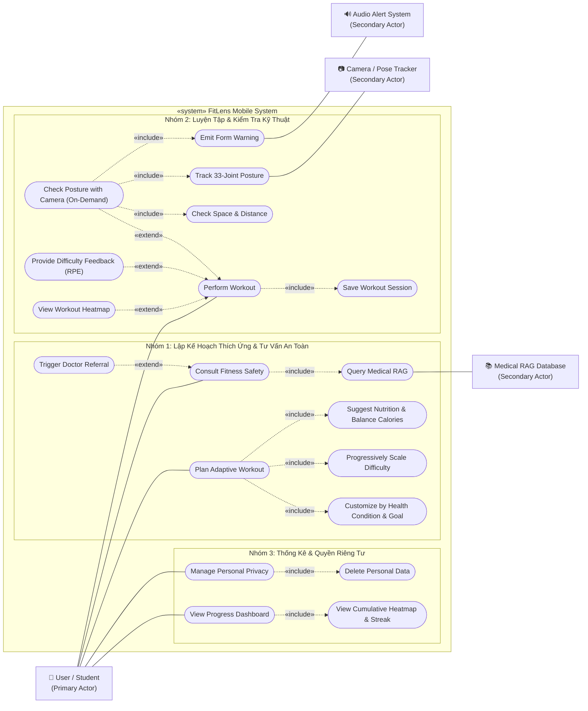
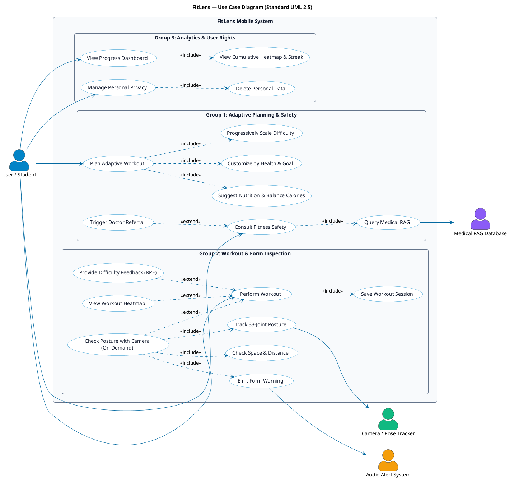

# FitLens — Sơ Đồ Ca Sử Dụng (Use Case Diagram) Chuẩn UML

> **Đồ án:** FitLens (AI Virtual Personal Trainer & Habit Coach)  
> **Môn học:** CS252 / CSC10014 — Computational Thinking (fit@hcmus)  
> **Nhóm thực hiện:** Group_01  
> **Tài liệu gửi THA:** Báo cáo phân tích thiết kế Use Case Diagram

---

## 1. Sơ Đồ Use Case Tổng Thể (Mermaid UML)

*Sơ đồ hiển thị trực tiếp trên GitHub, VS Code và các trình đọc Markdown hỗ trợ Mermaid.*

---

## 2. Mã Nguồn PlantUML (Chuẩn UML Quốc Tế)

*Có thể copy đoạn mã dưới đây vào [PlantText](https://www.planttext.com/) hoặc tiện ích PlantUML trong VS Code để kết xuất ảnh SVG/PNG vector chất lượng cao.*

---

## 3. Luận Điểm Thiết Kế & Biện Luận Chuẩn UML (Gửi THA)

Bản thiết kế này giải quyết triệt để các bẫy thường gặp trong Use Case Diagram nhằm bảo vệ điểm số:

### 1. Phân định ranh giới hệ thống (System Boundary) & Actor
- **Tại sao không có Actor "AI Engine"?**  
  Theo chuẩn UML, Actor bắt buộc phải là thực thể **bên ngoài** hệ thống phần mềm đang xây dựng. FitLens bản chất là một phần mềm tích hợp AI, do đó các mô hình thuật toán và Rules Engine nằm **bên trong** ranh giới hệ thống (`FitLens System`).
- **Các External Systems thực sự:**
  - `Camera / Pose Tracker`: Giao tiếp phần cứng camera và API cảm biến thiết bị.
  - `Audio Alert System`: Hệ thống phát âm thanh cảnh báo của hệ điều hành.
  - `Medical RAG Database`: Cơ sở tri thức y khoa đối soát độc lập bên ngoài.

### 2. Quan hệ của Camera là `«extend»` thay vì `«include»`
- **Góc nhìn hành vi (Behavioral UX):** Camera **không phải là yêu cầu bắt buộc** cho toàn bộ buổi tập. Người dùng tập bình thường; chỉ khi gặp bài tập mới hoặc không chắc về tư thế, người dùng mới kích hoạt tính năng kiểm tra kỹ thuật.
- Do đó, `Check Posture with Camera` mở rộng (`«extend»`) vào `Perform Workout` khi có nhu cầu (On-Demand), giúp ứng dụng tiết kiệm pin, tránh làm nóng máy và giảm áp lực tâm lý cho người mới tập.

### 3. Cơ chế an toàn y tế (`Trigger Doctor Referral`) là `«extend»`
- Khi người dùng hỏi đáp tư vấn bài tập (`Consult Fitness Safety`), nếu người dùng đề cập đến chấn thương cấp tính hoặc đau nhói, kịch bản chuyển tuyến bác sĩ (`Trigger Doctor Referral`) mới được kích hoạt để ngắt hội thoại và khuyên đi khám chuyên khoa.

### 4. Tránh lỗi phân rã chức năng (Functional Decomposition)
- Tuyệt đối không đưa các thao tác giao diện như *"Lọc theo ngày/tuần/tháng"*, *"Đổi tab"* hay *"Nhập text"* thành Use Case con. Toàn bộ thao tác theo dõi tiến trình được gom chuẩn mực vào `View Progress Dashboard`.

---

## 4. Bảng Tóm Tắt Đặc Tả Các Ca Sử Dụng Trọng Tâm

| Mã UC | Tên Ca Sử Dụng | Tác Nhân | Loại Quan Hệ | Mô Tả Ý Nghĩa Nghiệp Vụ |
| :--- | :--- | :--- | :---: | :--- |
| **UC01** | `Plan Adaptive Workout` | User | **Base** | Tự động sinh lịch tập tuần thích ứng theo thể trạng và mục tiêu. |
| **UC01.1**| `Customize by Health & Goal` | Hệ thống | `«include»` | Lọc bỏ các bài tập va chạm mạnh nếu có tiền sử đau thắt lưng/khớp gối. |
| **UC01.2**| `Progressively Scale Difficulty`| Hệ thống | `«include»` | Tăng tiến độ khó mượt mà dựa trên dữ liệu phản hồi (chống nản ngày đầu). |
| **UC01.3**| `Suggest Nutrition & Balance Calories`| Hệ thống| `«include»` | Gợi ý bữa ăn sinh viên; tính toán hiệp tập bù trừ năng lượng thặng dư. |
| **UC02** | `Consult Fitness Safety` | User, MedicalDB | **Base** | Hỏi đáp kiến thức bài tập và bảo vệ khớp với HLV ảo. |
| **UC02.1**| `Trigger Doctor Referral` | Hệ thống | `«extend»` | Kích hoạt cảnh báo dừng tập, khuyên đi khám khi báo đau nặng. |
| **UC03** | `Perform Workout` | User | **Base** | Tiến hành buổi tập theo giáo án cá nhân hóa. |
| **UC03.1**| `Save Workout Session` | Hệ thống | `«include»` | Tự động lưu số hiệp, reps hoàn thành và thời gian vào SQLite. |
| **UC03.2**| `Check Posture with Camera` | User, PoseTracker, AudioSys | `«extend»` | Bật camera kiểm tra góc khớp khi người dùng có nhu cầu (On-Demand). |
| **UC03.3**| `Provide Difficulty Feedback` | User | `«extend»` | Đánh giá độ mệt RPE (1–10) sau buổi tập để AI điều chỉnh buổi sau. |
| **UC03.4**| `View Workout Heatmap` | User | `«extend»` | Xem bản đồ nhiệt 2D cơ bắp được kích hoạt ngay sau buổi tập. |
| **UC04** | `View Progress Dashboard` | User | **Base** | Theo dõi chuỗi streak, tổng volume và bản đồ nhiệt tích lũy. |
| **UC05** | `Manage Personal Privacy` | User | **Base** | Quyền riêng tư theo Nghị định 13/2023/NĐ-CP, cho phép xóa sạch dữ liệu. |
