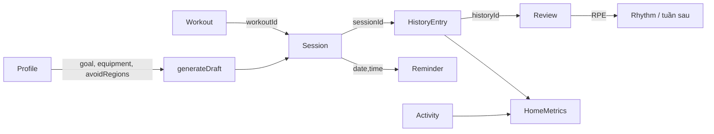

# FitLens — Data Contract (phần dùng chung)

> **Bản nháp đề xuất, chưa ai xác nhận.** Soạn 2026-11-14 cho prototype (hạn CN 15/11). Mục nào ghi **[CHỐT]** là cần cả 5 người đồng ý trước khi code. Mục **[ĐỀ XUẤT]** là mặc định hợp lý, sửa được.
> Chỉ gồm phần dùng chung. Cấu trúc riêng của từng người do chủ sở hữu tự viết (xem mục 9).

## 0. Nguyên tắc

1. **Một dữ liệu, một chủ sở hữu.** Chỉ chủ sở hữu được ghi. Người khác đọc qua hàm, **không đọc/ghi thẳng `localStorage`**.
2. **Model là JS thuần.** Không đụng DOM, không lẫn `localStorage` trong logic. Lớp lưu trữ tách riêng để sau này thay bằng SQLite hoặc API mà logic không đổi.
3. **Không lưu thứ tính được.** Ví dụ tổng thời lượng, tổng thiết bị, streak đang chạy. Lưu thêm là thêm một chỗ phải đồng bộ.
4. **Thiếu dữ liệu không được làm app vỡ.** Mọi hàm đọc phải trả về giá trị mặc định hoặc `null` hợp lệ, không ném lỗi.
5. **An toàn trước.** Mọi bộ lọc theo vùng cần tránh dùng chung một bộ giá trị (mục 1), vì lệch một chữ là lọc hỏng mà không báo lỗi.

## 1. Bộ giá trị dùng chung (enum) **[CHỐT]**

Định nghĩa **một lần** trong `prototype/shared/constants.js`, mọi người import. Không ai tự gõ chuỗi tay.

| Enum | Giá trị | Ghi chú |
| :-- | :-- | :-- |
| `Region` | `knees`, `back`, `wrists`, `shoulders`, `ankles`, `hips` | Vùng cơ thể: vừa là "vùng cần tránh" (Thông), vừa là vùng chịu tải của bài (Hải), vừa là vùng khó chịu sau buổi (Tu). Nếu cần thêm vùng, thêm ở đây. |
| `Equipment` | `dumbbells`, `bands`, `mat`, `bench`, `barbell`, `machine` | `[]` nghĩa là không cần dụng cụ. Không có giá trị `"none"` (form onboarding cũ có lựa chọn `none`, khi lưu đổi thành `[]`). Khớp `setup-plan-model.js`, thêm `barbell` và `machine` cho các bài phòng gym trong `catalog` cũ. |
| `Goal` | `habit`, `strength`, `muscle`, `endurance` | Lấy từ `setup-plan-model.js` hiện có. |
| `Experience` | `new`, `returning`, `regular` | Khớp `setup-plan-model.js` đang dùng. Thông xác nhận. |
| `Place` | `home`, `gym` | Khớp `setup-plan-model.js`. Thêm giá trị khi UI thật sự cần. |
| `SessionStatus` | `planned`, `done`, `skipped` | Chủ sở hữu: Hải. Buổi dừng vì đau vẫn là `done`, cờ `stoppedByPain` nằm ở `HistoryEntry`. |
| `ActivityType` | `walk`, `run`, `cycle`, `swim`, `other` | Đỗ Huy. |
| `Muscle` | `chest`, `back`, `shoulders`, `arms`, `legs`, `glutes`, `core` | **[ĐỀ XUẤT]** Nhóm cơ của bài tập, dùng cho training focus (Thông). |
| `ExerciseFeedback` | `tooEasy`, `justRight`, `tooHard`, `painful` | **[ĐỀ XUẤT]** Phản hồi từng bài trong check-in (Tu xác nhận). |
| `Rpe` | số nguyên 1–10 | Borg CR10, hỏi một lần sau buổi. Không phải tín hiệu chấn thương. |
| `Mood` | _Đỗ Huy liệt kê_ | Biểu cảm mascot. |

Quy tắc: giá trị enum luôn là chuỗi chữ thường, `camelCase` nếu nhiều từ, tiếng Anh. Giá trị lạ đọc từ storage phải bị bỏ qua hoặc đổi về mặc định, không được làm hỏng màn hình.

## 2. Định dạng chung **[CHỐT]**

| Thứ | Định dạng | Ví dụ | Ghi chú |
| :-- | :-- | :-- | :-- |
| Ngày | `YYYY-MM-DD` | `2026-11-16` | Ngày theo múi giờ `Asia/Ho_Chi_Minh` (hằng số duy nhất trong `shared/dates.js`, giống `setup-plan-model.js`), không phải UTC. Không lưu giờ cùng ngày. |
| Giờ trong ngày | `HH:mm` 24h | `18:30` | Tùy chọn, có thể `null`. |
| Thời điểm tạo/sửa | ISO 8601 UTC | `2026-11-14T09:30:00Z` | Chỉ dùng cho `createdAt`, `updatedAt`. |
| Đầu tuần | **Thứ Hai** | `weekStart = 2026-11-09` | **[CHỐT]** Tuần là thứ Hai đến Chủ nhật (quen thuộc ở Việt Nam). Hàm `weekStartOf(date)` ở `shared/dates.js`, mọi người dùng chung, không tự tính. |
| ID | chuỗi `<tiền tố>-<id ngẫu nhiên>` | `wk-8f3a1c`, `ss-2b91d4` | Không dùng số thứ tự. Tiền tố cố định mỗi thực thể (mục 3). Template dùng ID cố định, ví dụ `tpl-upper`. |
| Số đo | kg: số, có thể thập phân; reps, sets: số nguyên; thời gian: **giây** (số nguyên) | | Mọi thời lượng lưu bằng giây hoặc phút, **phải ghi đơn vị vào tên trường**: `durationSec`, `minutes`. |
| Trường rỗng | `null` cho "chưa có", `[]` cho "danh sách rỗng" | | Không dùng chuỗi rỗng hay `undefined` để biểu thị "chưa có". |

## 3. Tiền tố ID và chủ sở hữu

| Thực thể | Tiền tố ID | Chủ sở hữu (được ghi) | Mục chi tiết |
| :-- | :-- | :-- | :-- |
| Profile | `pf-` (chỉ 1 bản) | Thông | file riêng |
| Exercise (danh mục bài tập, hằng số) | `chair-squat` (kebab-case, cố định) | Hải (`shared/exercises.js`) | mục 9 |
| Workout | `wk-` (custom), `tpl-` (template) | Hải | file riêng |
| Session (buổi trên lịch) | `ss-` | Hải | file riêng |
| HistoryEntry (buổi đã tập) | `hs-` | Đức Huy | file riêng |
| Review (check-in sau buổi) | `rv-` | Đức Huy ghi qua `appendReview` (**[CHỐT]**, xem mục 6) | file riêng |
| Rhythm (mục tiêu tuần, streak) | — (1 bản) | Tu | file riêng |
| Reminder | `rm-` (`sessionId = null` là mặc định cho cả lịch) | Tu | file riêng |
| Activity | `ac-` | Đỗ Huy | file riêng |

## 4. Quy ước lưu trữ **[CHỐT]**

**Key localStorage:** `fitlens.<thực thể>`, chữ thường. Ví dụ `fitlens.profile`, `fitlens.workouts`, `fitlens.sessions`, `fitlens.history`.

**Cấu trúc giá trị:** mỗi key lưu một "phong bì" có phiên bản, không gắn `schemaVersion` vào từng bản ghi:

```json
{ "v": 1, "data": [ ... ] }
```

(Với thực thể chỉ có một bản như Profile thì `data` là một object.)

**Quy tắc đọc/ghi** (trong `shared/storage.js`, mọi người dùng chung):
- `read(key, fallback)`: bọc `try/catch`, JSON hỏng hoặc thiếu key thì trả `fallback`, không ném lỗi.
- `write(key, data)`: tự gói `{v, data}`. Nếu `localStorage` đầy hoặc bị chặn thì báo lỗi nhẹ cho UI, không làm sập trang.
- Đọc thấy `v` thấp hơn phiên bản hiện tại thì gọi hàm `migrate` của chủ sở hữu (mục 7). Đọc thấy `v` **cao hơn** thì không ghi đè, chỉ đọc phần hiểu được.

**sessionStorage** chỉ dành cho trạng thái tạm trong một phiên (ví dụ buổi tập đang diễn ra của Đức Huy), key `fitlens.session.<tên>`. Không đặt dữ liệu cần giữ lâu vào đây.

**Dữ liệu mẫu (fixture):** key `fitlens.seed` (boolean) đánh dấu đã nạp dữ liệu mẫu. Xem mục 8.

## 5. Quan hệ giữa các thực thể



**Khóa ngoại** (chuỗi ID, kiểm tra tồn tại khi đọc):
- `Session.workoutId` → `Workout.id`
- `HistoryEntry.sessionId` → `Session.id` (có thể `null` nếu tập tự do, không từ lịch)
- `HistoryEntry.workoutId` → `Workout.id` (lưu kèm để lịch sử không mất ý nghĩa khi buổi bị xóa)
- `Review.historyId` → `HistoryEntry.id`
- `Reminder.sessionId` → `Session.id`

**Khi tham chiếu đứt** (đối tượng bị xóa): màn hình hiển thị "không còn tồn tại", không crash. Quy tắc xóa **[CHỐT]**:
- Xóa `Workout`: chặn nếu còn `Session` `planned` trỏ tới. Hiện thông báo yêu cầu gỡ buổi trước.
- Xóa `Session`: các `Reminder` của nó bị xóa theo (Tu xử lý trong hàm của mình khi nhận sự kiện hoặc kiểm tra lúc đọc). Thông báo trên điện thoại: Tu tự đồng bộ lại mỗi khi lịch đổi (nghe `subscribe()` của storage); Hải, Đức Huy **không cần gọi gì** khi dời, xóa hay hoàn tất buổi.
- `HistoryEntry` và `Review` **không bao giờ bị xóa theo** workout hay session; đó là lịch sử.

## 6. Hàm giao nhau (hợp đồng chữ ký) **[CHỐT]**

Mỗi người xuất một đối tượng `window.FitLens<Tên>`. Kiểu trả về dưới đây là bắt buộc; nội dung chi tiết do chủ sở hữu viết ở file riêng. Mọi hàm **đồng bộ** (không Promise) trong prototype.

| Hàm | Chủ sở hữu | Trả về | Người dùng |
| :-- | :-- | :-- | :-- |
| `getProfile()` | Thông | `Profile` (luôn có object, trường chưa điền theo mặc định ở mục 9) | Hải, Đỗ Huy, Tu |
| `getHomeMetrics(date)` | Thông | `HomeMetrics` (dùng dữ liệu mẫu nếu chưa có lịch sử) | Đỗ Huy (Home) |
| `getSteps(date)` | Thông | `{date, steps}` (dữ liệu mẫu trong prototype) | Đỗ Huy, Thông |
| `getWorkout(id)` | Hải | `Workout \| null` | Đức Huy, Đỗ Huy |
| `updateWorkout(id, patch)` | Hải | `Workout` | Hải (Builder) |
| `getWeekSchedule(weekStart)` | Hải | `Session[]` sắp theo ngày rồi giờ | Tu, Đỗ Huy, Thông |
| `markSessionDone(sessionId)` | Hải | `Session \| null` (`null` nếu không tìm thấy) | Đức Huy |
| `updateSession(id, {date?, time?})` | Hải | `{ok:true, session}` hoặc `{ok:false, reason}` với `reason` là `notFound`, `invalidDate`, `invalidTime`, `conflict` (cùng ngày cùng giờ), `storage`. Chỉ đổi ngày/giờ. | Tu, Hải (Plan) |
| `getNextSession(now)` | Hải | `Session \| null` (buổi `planned` gần nhất từ `now`) | Đỗ Huy, Tu |
| `getHistory(filter?)` | Đức Huy | `HistoryEntry[]` mới nhất trước. `filter = {from?, to?, workoutId?, exerciseId?}` (ngày bao gồm hai đầu) | Tu, Thông, Đỗ Huy, Hải |
| `getLastSets(exerciseId)` | Đức Huy | `SetRecord[]` của lần tập gần nhất, hoặc `[]` | Đức Huy (màn tập) |
| `appendReview(review)` | Đức Huy | `Review` đã lưu | Tu (màn check-in gọi) |
| `getReview(historyId)` | Đức Huy | `Review \| null` | Tu, Thông |
| `getReviews({from?, to?})` | Đức Huy | `Review[]` mới nhất trước | Hải (RPE tuần trước), Thông (gợi ý xác nhận vùng tránh), Tu |
| `getRhythm(date)` | Tu | `Rhythm` | Đỗ Huy, Thông |
| `getReminder(sessionId)` | Tu | `Reminder \| null` (nếu buổi chưa có nhắc riêng thì trả nhắc mặc định `sessionId = null`) | Hải (Plan), Tu |
| `setReminder(sessionId, {enabled, minutesBefore})` | Tu | `Reminder`. `minutesBefore` chỉ nhận `0`, `15`, `30` | Hải (Plan), Tu |
| `getLoadAdjustForWeek(weekStart)` | Tu | số −0.3…+0.1 (giảm/tăng tải tuần sau theo RPE và báo đau tuần trước) | Hải (`generateDraft`) |
| `setMascotMood(mood)` | Đỗ Huy | `void` | Tu, Đức Huy |
| `getActivities({from?, to?})` | Đỗ Huy | `Activity[]` | Thông (Insights, Home) |
| `renderActivitySection(el)` | Đỗ Huy | `void` | Hải (trang Workouts) |

**`appendReview` [CHỐT]:** Đức Huy định nghĩa trong `mobile/src/modules/history/history.ts` (đúng theo bảng phân công của anh ấy). Tu gọi từ màn check-in (`submitCheckIn`). Tu không ghi thẳng vào lịch sử.

Chữ ký (khớp `ReviewRepository<Review>` trên nhánh `codex/npdwuy-training-foundation`, 19/11/2026):

```ts
appendReview(review: Review): Review            // đồng bộ, trả bản đã lưu
getReview(historyId: string): Review | null
getReviews(range?: { from?: DateKey; to?: DateKey }): Review[]   // mới nhất trước
```

- Kiểu `Review` do Tu giữ, ở `mobile/src/modules/checkin/review-model.ts`; Đức Huy import, không định nghĩa lại.
- Tu tạo `review.id` (`rv-`) và `createdAt` qua `buildReview()`; `appendReview` lưu nguyên, không đổi.
- Mỗi `historyId` một review: lưu lại thì **thay** review cũ.
- `getReviews` lọc theo ngày lịch địa phương của `createdAt`.
- **Ghi bền (đang làm, Đức Huy, nhánh `feature/npdwuy-training`):** ghi cache đồng bộ chưa chắc đã lưu xuống AsyncStorage, nên Đức Huy thêm `appendReviewDurable(review): Promise<Review>` (chỉ trả về khi đã lưu xuống máy) và màn check-in gọi `submitCheckInDurable()`. Tu đồng ý cách này. `appendReview` đồng bộ vẫn giữ nguyên chữ ký cho các chỗ khác.

**Quy ước hàm:**
- Hàm đọc không có tác dụng phụ.
- Hàm ghi chỉ ghi dữ liệu của mình, trả về bản ghi sau khi ghi.
- Đầu vào sai (ID không tồn tại, enum lạ) thì trả `null`/giá trị mặc định kèm `console.warn`, không ném lỗi.
- Thay đổi chữ ký hàm trong bảng trên phải báo cả nhóm trước (xem mục 10).

## 7. Phiên bản và migration

- `v` bắt đầu từ `1`. Khi chủ sở hữu đổi cấu trúc, tăng `v` và viết hàm `migrate(oldEnvelope)` trả về envelope mới. Chỉ chủ sở hữu viết migration cho dữ liệu của mình.
- Chỉ cho phép đổi cấu trúc theo hướng **thêm trường tùy chọn** mà không tăng `v`. Đổi tên, xóa hoặc đổi kiểu trường thì phải tăng `v`.
- Prototype chưa có dữ liệu thật của người dùng, nên trong giai đoạn này cho phép xóa localStorage khi đổi cấu trúc, miễn là báo nhóm.

## 8. Dữ liệu mẫu (fixture) dùng chung **[ĐỀ XUẤT]**

File `prototype/shared/seed.js`, nạp một lần khi `fitlens.seed` chưa đặt, để mọi người chạy phần mình khi phần người khác chưa xong:
- 1 Profile mẫu (mục tiêu `habit`, 3 ngày/tuần, không dụng cụ, vùng tránh `[]`) và 1 Profile mẫu có vùng tránh (`wrists`).
- Các workout template.
- Một tuần lịch mẫu và 3–4 buổi lịch sử mẫu (có RPE) để Home, Insights, streak có số liệu.

Mỗi chủ sở hữu viết seed cho **dữ liệu của mình** trong file riêng, `seed.js` chỉ gọi lần lượt. Nút "Reset dữ liệu mẫu" xóa mọi key `fitlens.*` rồi nạp lại.

## 9. Phần riêng của từng người (ngoài phạm vi file này)

File này **chỉ** định nghĩa phần dùng chung. Cấu trúc chi tiết của từng thực thể do chủ sở hữu tự viết ở file riêng, theo đúng các quy tắc ở mục 0–8:

| Thực thể | Chủ sở hữu | File chi tiết |
| :-- | :-- | :-- |
| Profile, HomeMetrics | Thông | _chưa có_ |
| Workout, Session | Hải | `WORKOUT_SCHEDULE_DESIGN.md` |
| HistoryEntry, SetRecord | Đức Huy | _chưa có_ |
| Review, Rhythm, Reminder | Tu | `RHYTHM_CHECKIN_REMINDER.md` |
| Activity, Mascot, Route | Đỗ Huy | _chưa có_ |

**Trường tối thiểu mà người khác cần đọc** (phần giao nhau, người sở hữu có thể thêm trường nhưng không được bỏ các trường này):
- `Profile`: `goal`, `experience`, `daysPerWeek`, `minutes`, `equipment`, `avoidRegions`. Mặc định khi chưa onboarding: `habit`, `new`, `3`, `30`, `[]`, `[]`.
- `Session`: `id`, `workoutId`, `date`, `time`, `status`.
- `HistoryEntry`: `id`, `sessionId`, `workoutId`, `date`, `durationSec`, `stoppedByPain`.
- `Review`: `id`, `historyId`, `rpe`, `discomfortRegions`, `exerciseFeedback` (`[{exerciseId, feedback: ExerciseFeedback}]`).
- `Exercise`: `id`, `name`, `regions`, `equipment`, `muscles`.
- `Reminder`: `id`, `sessionId` (nullable), `enabled`, `minutesBefore`.
- `Rhythm`: `weeklyGoal` (nullable; `null` nghĩa là dùng `Profile.daysPerWeek`, không lưu trùng), `streakWeeks` (tính ra: số tuần liên tiếp đạt mục tiêu, **Tu xác nhận**), `pausedUntil`.
- `HomeMetrics`: `{date, steps, activeMinutes, activeEnergyKcal | null, isSample}`.
- `Activity`: `id`, `type`, `date`, `durationSec`, `distanceKm | null`.

Quy tắc an toàn: `discomfortRegions` (Tu) là tạm thời, **không tự cập nhật `avoidRegions`**. Chỉ hồ sơ (Thông) đổi `avoidRegions` khi người dùng xác nhận.

## 10. Quy trình thay đổi hợp đồng

1. Chỉ **chủ sở hữu** đổi cấu trúc dữ liệu của mình. Đổi phần dùng chung (mục 1, 2, 4, 6) thì phải có sự đồng ý của người bị ảnh hưởng.
2. Mọi thay đổi vào file này đi qua PR, ghi rõ ai bị ảnh hưởng.
3. Đổi chữ ký hàm ở mục 6: nhắn nhóm trước, giữ hàm cũ chạy được một thời gian ngắn nếu có người đang dùng.
4. Mỗi hàm xuất ra có ít nhất vài test thuần JS (đầu vào, đầu ra) để biết khi nào ai làm hỏng hợp đồng.

## 11. Danh sách cần chốt (tóm tắt)

| # | Việc | Đề xuất mặc định | Cần ai |
| :-- | :-- | :-- | :-- |
| 1 | Giá trị `Region`, `Equipment`, `Goal` | Như mục 1 | Thông, Hải, Tu |
| 2 | `Experience`, `Place`, `Mood` | Như mục 1; Đỗ Huy bổ sung `Mood` | Thông, Đỗ Huy |
| 3 | Tuần bắt đầu từ | Thứ Hai | Cả nhóm |
| 4 | Phong bì `{v, data}` và key `fitlens.<tên>` | Như mục 4 | Cả nhóm |
| 5 | Ai định nghĩa `appendReview` | Đức Huy | Tu, Đức Huy |
| 6 | Ai giữ `Session.status` | Hải (Đức Huy gọi `markSessionDone`) | Hải, Đức Huy |
| 7 | Quy tắc xóa Workout/Session | Như mục 5 | Hải, Tu, Đức Huy |
| 8 | Hàm đồng bộ, không Promise | Như mục 6 | Cả nhóm |
| 9 | Thư mục `prototype/shared/` cho constants, dates, storage, routes, seed | Như mục 8 | Cả nhóm (ai tạo khung: Hải đề xuất làm) |

## 12. Điều hướng giữa các trang **[CHỐT]**

Tên trang lấy từ `shared/routes.js` (không có `food`, `chat`). Dữ liệu truyền giữa trang bằng tham số URL với **tên cố định**:

| Tham số | Giá trị | Dùng khi |
| :-- | :-- | :-- |
| `session` | `Session.id` | Mở chi tiết/bắt đầu một buổi trên lịch |
| `workout` | `Workout.id` | Mở chi tiết/bắt đầu một workout không qua lịch |
| `history` | `HistoryEntry.id` | Từ màn tập sang check-in (`Review.historyId`) |
| `week` | `weekStart` (`YYYY-MM-DD`) | Mở Plan ở một tuần cụ thể |
| `date` | `YYYY-MM-DD` | Mở một ngày cụ thể |

Thiếu hoặc sai tham số thì trang quay về trang cha, không báo lỗi trắng màn hình.
