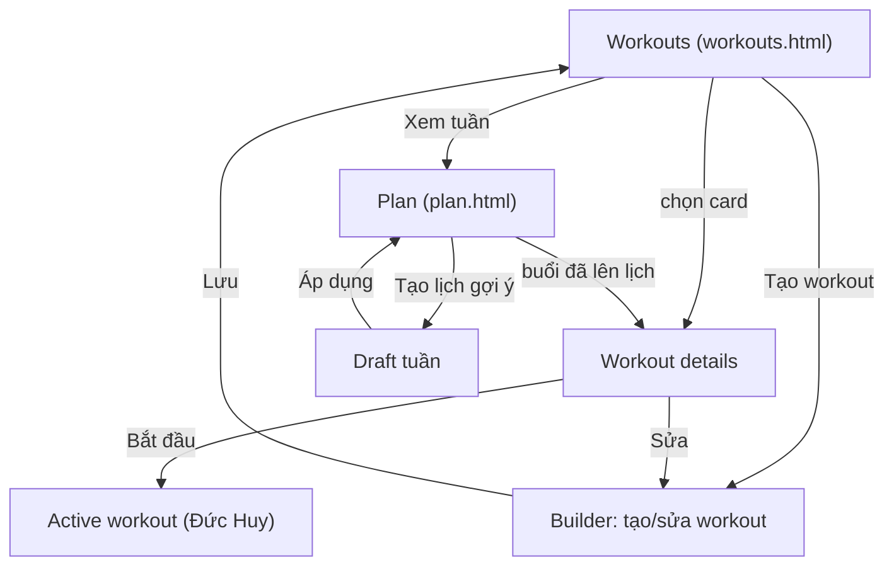

# Thiết kế: Workout & Lịch tuần (phần của Hải)

> Nhánh: `feature/workout-schedule` · Hạn prototype: CN 15/11/2026 · Trạng thái: **bản nháp thiết kế, chưa code**.
> Phạm vi lấy từ bảng phân công trong `docs/PROJECT_STATE.md` (mục 7). Các tên hàm, key lưu trữ và schema dưới đây là **đề xuất**, cần chốt với Thông và Đức Huy.

## 1. Phạm vi

**Làm:** thư viện workout, trang Workouts, trang Workout details, lịch tuần (trang Plan), sinh draft từ hồ sơ.
**Không làm:** buổi tập đang diễn ra và lịch sử (Đức Huy), hồ sơ và vùng cần tránh (Thông), check-in và nhắc lịch (Tu), Home và dock (Đỗ Huy).
**Gỡ:** nút "Ask FitLens" khỏi Workout details (Chat đã bỏ khỏi phạm vi).

## 2. Màn hình và luồng

Các ảnh tham chiếu nằm trong `design/ui-snapshots/2026-10-28/` (số là ID snapshot).



| Màn hình | Chức năng | Snapshot tham chiếu |
| :-- | :-- | :-- |
| Workouts | Routine mẫu, workout riêng, lịch sắp tới | 003, 082 |
| Workout details | Xem bài tập, bắt đầu, xem trước camera, **không còn "Ask FitLens"** | 004 |
| Builder | Tạo mới, thêm/sửa bài, đổi thứ tự, thư viện bài tập, lưu | 005, 070–073, 080–081 |
| Điều chỉnh workout | Đổi thời lượng, thiết bị, mức năng lượng, có xem trước | 074–079 |
| Plan | Lịch tuần trống, nhiều workout/ngày, chọn giờ, xung đột, thêm/đổi/xóa, kéo thả, sao chép tuần | 006, 083–090, 095 |
| Draft tuần | Chọn trọng tâm, ngày, thiết bị, xem draft rồi áp dụng | 091–094 |

## 3. Mô hình dữ liệu (đề xuất)

```ts
type Exercise = {
  id: string; name: string;
  muscles: string[];            // ví dụ ["chest","triceps"]
  equipment: string[];          // [] = không cần dụng cụ
  regions: string[];            // vùng cơ thể chịu tải, để đối chiếu avoid_tags
};

type WorkoutItem = { exerciseId: string; sets: number; reps?: number; seconds?: number };

type Workout = {
  id: string; title: string;
  source: "template" | "custom";    // template: chỉ đọc, sửa thì tạo bản sao custom
  items: WorkoutItem[];
  minutes: number;                  // ước lượng
  equipment: string[];              // gộp từ các bài
  level: "easy" | "medium" | "hard";
  updatedAt: string;                // ISO
};

type Session = {                    // một buổi trên lịch
  id: string; workoutId: string;
  date: string;                     // YYYY-MM-DD
  time?: string;                    // HH:mm, tùy chọn
  status: "planned" | "done" | "skipped";   // done do Đức Huy đặt khi hoàn tất
};

type WeekSchedule = { weekStart: string; sessions: Session[]; draft?: boolean };
```

Lưu ở localStorage, **một nơi duy nhất cho mỗi loại dữ liệu**: `fitlens_workouts` (workout custom) và `fitlens_sessions` (buổi trên lịch). Template là hằng số trong code, không lưu.

## 4. API module (xuất cho người khác)

File đề xuất: `prototype/workout-model.js` (thuần dữ liệu, không đụng DOM), gắn vào `window.FitLensWorkout`.

| Hàm | Mô tả | Ai dùng |
| :-- | :-- | :-- |
| `getWorkout(id)` | Trả về workout (template hoặc custom) | Đức Huy (màn tập), Đỗ Huy (Home) |
| `updateWorkout(id, patch)` | Sửa workout custom; với template thì tạo bản sao custom và trả về bản sao | Builder |
| `listWorkouts()` | Template + custom | Workouts |
| `createWorkout(data)`, `deleteWorkout(id)` | Tạo / xóa workout custom (xóa thì hỏi cách xử lý các buổi đang trỏ tới nó) | Builder |
| `getWeekSchedule(weekStart)` | Danh sách buổi trong tuần | Home, Tu (nhắc lịch), Thông (chỉ số) |
| `generateDraft(profile, weekStart)` | Sinh draft từ hồ sơ, không ghi lưu | Plan |
| `applyDraft(draft)` | Ghi draft thành lịch thật | Plan |
| `addSession`, `moveSession`, `removeSession`, `copyWeek` | Thao tác trên lịch | Plan |

**Phụ thuộc vào người khác**
- Thông: `getProfile()` cần trả `goal`, `level`, `daysPerWeek`, `minutes`, `equipment`, `avoidRegions`. Draft không được xếp bài chạm vùng tránh.
- Đức Huy: khi xong buổi, cập nhật `Session.status = "done"` qua một hàm chung (cần chốt: ai sở hữu `status`).
- Tu: đọc `getWeekSchedule()` để đặt nhắc, ghi `time` qua `moveSession`/`updateSession`.

## 5. Thuật toán sinh draft (chạy ở client)

Nối tiếp ý tưởng đã có trong `prototype/setup-plan-model.js` (`patterns` theo số ngày, `library` có `regions`, `equipment`, `goals`):

1. Chọn mẫu ngày theo `daysPerWeek` (2, 3, 4, 5), giãn cách để có ngày nghỉ.
2. Lọc workout: bỏ bài cần dụng cụ người dùng không có, bỏ bài chạm `avoidRegions`.
3. Xếp theo mục tiêu (habit, strength, muscle, endurance), xen kẽ nhóm cơ để không tập cùng nhóm hai ngày liền.
4. Cắt cho vừa `minutes`.
5. Trả draft `draft: true`. Người dùng xem rồi mới áp dụng.

Ghi chú: vòng "RPE tuần trước → tuần này nhẹ/nặng hơn" thuộc Tu (check-in), Hải chỉ cần hàm `generateDraft` nhận thêm tham số `loadAdjust` (−30%…+10%) để sau này nối vào.

## 6. Việc cần làm (thứ tự đề xuất)

1. Chốt schema và API với Thông, Đức Huy, Tu (nhắn một lần, chốt trong ngày).
2. Viết `workout-model.js` + dữ liệu template + test thuần JS.
3. Nối Workouts và Workout details vào model; **gỡ "Ask FitLens"**.
4. Builder: tạo, sửa, xóa, đổi thứ tự.
5. Plan: xem tuần, thêm, đổi, xóa, kéo thả.
6. `generateDraft` + màn draft + `applyDraft`.
7. Sao chép tuần, xung đột giờ.
8. Rà lại với snapshot 003–095.

## 7. Câu hỏi mở

- `prototype/` trong repo chưa có `plan.html` và nhiều file mới. Cần bản mới nhất từ `D:\UI_Design` (máy hiện tại không có thư mục này), hoặc dựng lại từ snapshot.
- Ai sở hữu `Session.status` và lịch sử: Hải hay Đức Huy.
- Xóa workout đang được lên lịch: xóa luôn các buổi, hay giữ buổi và đánh dấu "workout đã xóa".
- Prototype dùng hằng số `routines` trong `workouts.js`; thay bằng model chung thì có làm hỏng trang của Đỗ Huy (Home) không.
