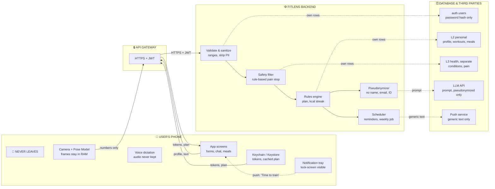

# Data Flow & Security: FitLens

**Môn học:** CS252 / CSC10014 — Computational Thinking (fit@hcmus)  
**Đề tài:** Project 01 — FitLens (AI Virtual Personal Trainer & Habit Coach)  
**Nền tảng:** Mobile App (iOS & Android)  
**Tài liệu liên quan:** [report.md](file:///d:/Courses/Computer%20Science/CS252%20-%20Computational%20Thinking/report.md), [Note.md](file:///d:/Courses/Computer%20Science/CS252%20-%20Computational%20Thinking/Note.md), [Group_01.pdf](file:///d:/Courses/Computer%20Science/CS252%20-%20Computational%20Thinking/Group_01.pdf)

---

## 1. Nguyên Tắc Thiết Kế

> *"Nếu ngày đầu đã quá khó thì sẽ chẳng ai muốn quay lại."*

* Toàn bộ dữ liệu đi qua **đúng 4 vùng tin cậy (Trust Zones)**, chỉ di chuyển theo **đường có nhãn rõ ràng**.
* Camera frames **không bao giờ rời khỏi điện thoại** — chỉ có con số (tọa độ khớp, điểm form) mới được truyền đi.
* Thu thập dữ liệu tối thiểu — không yêu cầu GPS, danh bạ, hay bất kỳ quyền nhạy cảm nào ngoài Camera.

---

## 2. Data Flow — 4 Trust Zones

> Dữ liệu đi qua 4 vùng tin cậy, chỉ theo các đường có nhãn.

**Cách đọc sơ đồ:**
| Vùng | Chứa gì | Đi ra bằng gì |
|:---|:---|:---|
| **User's Phone** | Camera frames, audio, tokens, UI | Chỉ gửi **số liệu & text** qua HTTPS |
| **API Gateway** | Lớp vận chuyển duy nhất | HTTPS + JWT, không có kênh phụ |
| **FitLens Backend** | Validate, Safety, Rules, Pseudonymizer | Mỗi module chỉ truy cập **đúng bảng của mình** |
| **Database & Third Parties** | Auth (hash), L2 personal, L3 health, LLM, Push | LLM chỉ nhận prompt đã xóa PII |

---

## 3. Dữ Liệu Lưu Trữ — Tổng Quan

Không sử dụng kiến trúc phức tạp. Chỉ cần **3 nhóm bảng** trong một cơ sở dữ liệu quan hệ đơn giản:

| Nhóm | Bảng | Nội dung chính |
|:---|:---|:---|
| **Auth** | `users` | email, password_hash, fitness_goal |
| **L2 — Personal** | `workout_sessions`, `meal_logs` | reps, thời gian, RPE, calo bữa ăn |
| **L3 — Health** | `health_conditions` | tiền sử bệnh cột sống, giới hạn vận động |

Dữ liệu bổ trợ:
| Bảng | Vai trò |
|:---|:---|
| `exercises` | Danh mục bài tập (tên, MET, góc ROM chuẩn) |
| `medical_knowledge` | Kiến thức y khoa đã đối soát, đánh dấu fitness myth |

> **Lưu ý:** Local database trên điện thoại (SQLite / Hive) cache lịch sử tập để hoạt động offline. Khi có mạng → đồng bộ lên server.

---

## 4. Giải Thuật Thích Ứng (Adaptive Pacing)

### 4.1. Tăng tiến cường độ dựa vào RPE

Sau mỗi buổi tập, user chọn **1 trong 3 mức cảm nhận**:

| RPE | Cảm nhận | AI phản ứng cho buổi tiếp theo |
|:---|:---|:---|
| **1 — Quá dễ** | Chưa mệt | Tăng +2 reps hoặc +5s giữ plank, giảm nghỉ 10s |
| **2 — Vừa sức** | Mỏi vừa đủ | Giữ nguyên 1–2 buổi để củng cố kỹ thuật |
| **3 — Quá mệt** | Bỏ dở, đau nhức | Giảm 30% rep, chuyển biến thể nhẹ hơn (Plank → Knee-Plank) |

### 4.2. Bù trừ năng lượng từ bữa ăn

Khi user nhập bữa ăn phụ nhiều calo (vd: burger ≈ 500 kcal):
$$\Delta \text{Sets} = \left\lceil \frac{\text{Calo nạp thêm} \times 0.6}{\text{MET} \times 3.5 \times \text{Cân nặng (kg)} / 200 \times \text{Thời gian 1 set (phút)}} \right\rceil$$

Số hiệp bù được **chia đều vào 2–3 buổi tập tiếp theo**, không ép dồn vào 1 ngày.

---

## 5. Bảo Mật — Khái Niệm Cơ Bản

### 5.1. Zero Video Retention (Camera Privacy)
* Camera frames chỉ tồn tại trên RAM vài ms → trích xuất 33 tọa độ khớp (x, y, z) → **hủy frame ngay**.
* Backend **không có API nào nhận file ảnh/video**.
* Người dùng yên tâm bật camera trong phòng riêng.

### 5.2. Data Minimization
* Chỉ thu thập: mục tiêu tập, tiền sử cột sống, reps, RPE, calo bữa ăn.
* Không yêu cầu GPS, danh bạ, micro nền.

### 5.3. Right to be Forgotten
* `ON DELETE CASCADE` trên tất cả bảng liên kết với `users`.
* User nhấn "Xóa tài khoản" → xóa sạch toàn bộ dữ liệu trên server, không giữ bản sao.

### 5.4. Mobile Security Tiêu Chuẩn
| Lớp | Cơ chế |
|:---|:---|
| Đường truyền | HTTPS / TLS 1.3 |
| Token | JWT lưu trong iOS Keychain / Android Keystore |
| SQL Injection | Parameterized Queries / ORM |
| Access Control | Mọi query đều gắn `WHERE user_id = :authenticated_user_id` |

---

## 6. Tech Stack Đề Xuất

| Thành phần | Công nghệ | Lý do |
|:---|:---|:---|
| Mobile Framework | Flutter / React Native | 1 codebase → iOS + Android |
| Local DB | SQLite / Hive | Offline-first, đọc/ghi nhanh |
| Pose Estimation | ML Kit / MediaPipe | On-device, tận dụng NPU/GPU |
| Push Notifications | FCM + Local Notifications | Nhắc lịch tập, duy trì streak |
| Backend | Express / FastAPI | Nhẹ, phản hồi < 30ms |
| Cloud DB | SQLite (demo) → PostgreSQL (prod) | Đơn giản, tin cậy |
