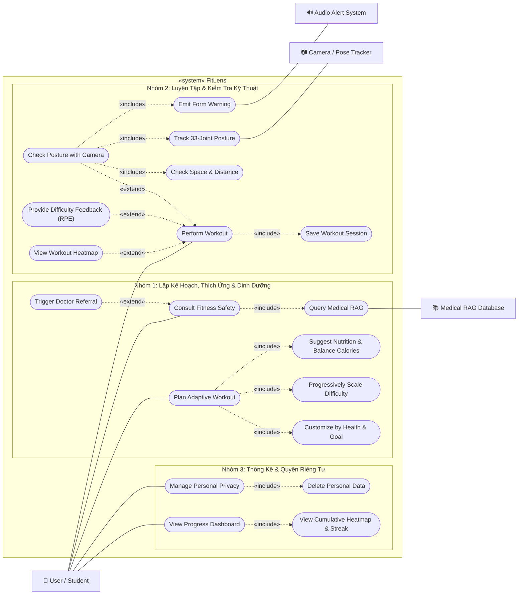
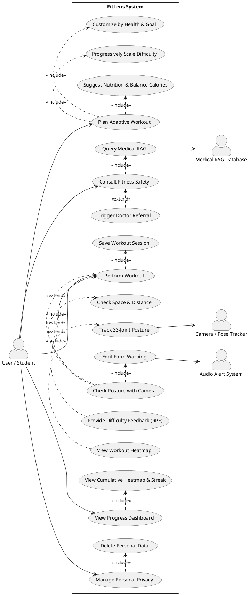
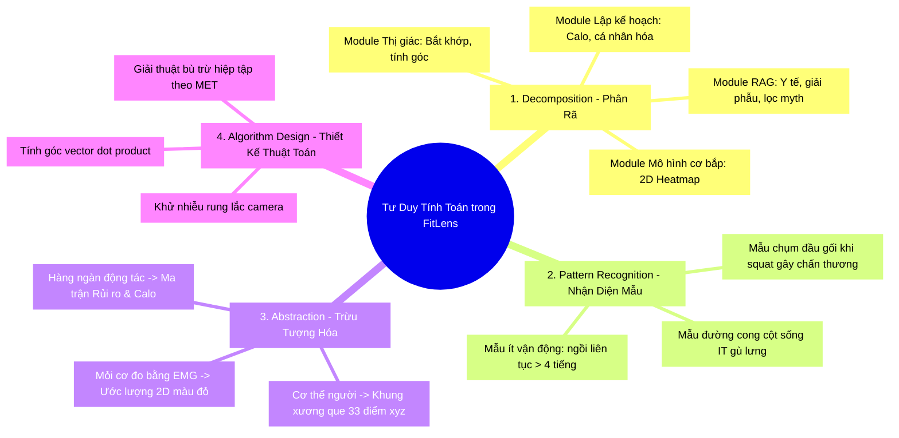
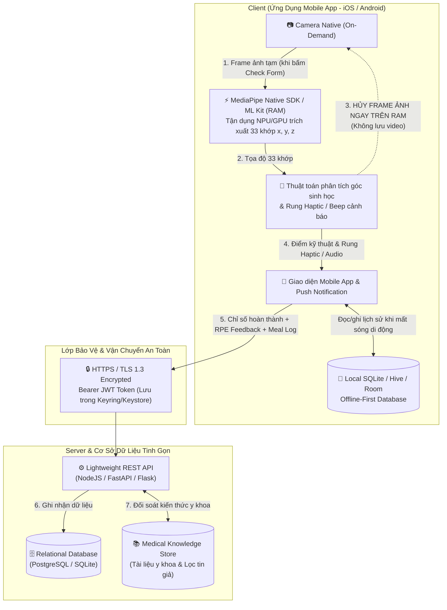
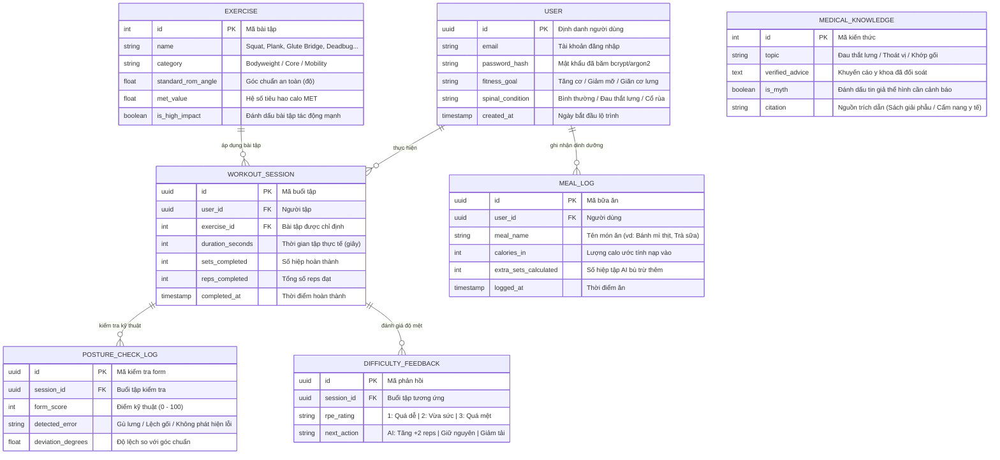

# Báo Cáo Phân Tích & Thiết Kế Use Case Diagram: FitLens

**Môn học:** CS252 / CSC10014 - Computational Thinking (fit@hcmus)  
**Đề tài chọn:** Project 01 — **FitLens (Smart Virtual Personal Trainer)**  
**Tài liệu tham chiếu:** `Group_01.pdf`, bài mẫu giảng viên `Note01_InClass.png`, bản phác thảo của Teammate.

---

## 1. Mục Tiêu & Yêu Cầu Đồ Án
* **Mục tiêu hệ thống:** Ứng dụng di động (Mobile App - iOS/Android) AI Virtual Personal Trainer đóng vai trò huấn luyện viên cá nhân ảo và người bạn đồng hành xây dựng thói quen vận động: cá nhân hóa lộ trình bài tập và thực đơn dinh dưỡng theo thể trạng/bệnh lý, tự động tăng tiến cường độ mượt mà dựa trên dữ liệu phản hồi (Progressive Pacing - chống nản ngày đầu), tận dụng thông báo đẩy (Push Notifications) để nhắc nhở kiên trì tập luyện, cung cấp trợ lý AI tư vấn và tính năng Camera On-Demand hỗ trợ kiểm tra kỹ thuật khi người dùng có nhu cầu.
* **Yêu cầu kỹ thuật:**
  * Xây dựng **Use Case Diagram (Sơ đồ ca sử dụng)** chuẩn UML.
  * **Tuyệt đối không vẽ Flowchart** (lưu đồ giải thuật/trình tự thực thi).
  * Tuân thủ quy chuẩn thiết kế như bài mẫu trên lớp (`Note01_InClass.png`): Có ranh giới hệ thống (*System Boundary*), phân định rõ Primary Actor (bên trái) và Secondary Actors / External Systems (bên phải), sử dụng đúng quan hệ `«include»` và `«extend»`.

---

## 2. Đánh Giá & Hoàn Thiện Bản Phác Thảo Của Teammate

### 2.1. Điểm tốt của Teammate
* Đã gom được 3 cụm nghiệp vụ trực quan: Chat/Tư vấn, Luyện tập (Workout), và Thống kê (Dashboard).
* Bắt đúng một số tính năng chủ chốt trong slide: `Check Space Safety`, `Track Posture & Warn`, `Medical Warning`, `View Muscle Heat Map`.

### 2.2. Các lỗi UML cần sửa để không bị trừ điểm
1. **Actor "AI Engine":** 
   * *Lỗi:* Actor phải là thực thể **bên ngoài hệ thống**. FitLens là một ứng dụng di động tích hợp AI, do đó lõi AI nằm bên trong ranh giới (System Boundary). 
   * *Khắc phục:* Thay "AI Engine" bằng các External Systems / Hardware Interfaces cụ thể: **Camera / Pose Tracker** và **Medical RAG Database**.
2. **Lỗi phân rã giao diện (Functional Decomposition):**
   * *Lỗi:* Đưa `Filter by Time Range` (lọc 1 tuần / 1 tháng) thành một Use Case con mở rộng (`«extend»`) là sai chuẩn UML (đây chỉ là một nút bấm/thao tác lọc trên UI).
   * *Khắc phục:* Bỏ Use Case này; việc lọc theo thời gian được tích hợp trực tiếp vào nội dung của Use Case `View Progress Dashboard`.
3. **Chiều mũi tên quan hệ UML (Tránh vẽ ngược):**
   * `«include»`: Mũi tên đứt nét có nhãn hướng từ **Base Use Case $\rightarrow$ Included Use Case** (bắt buộc phải thực hiện).
   * `«extend»`: Mũi tên đứt nét có nhãn hướng từ **Extension Use Case $\rightarrow$ Base Use Case** (chỉ kích hoạt khi thỏa điều kiện/ngoại lệ).
4. **Tránh biến Camera thành yêu cầu bắt buộc toàn bộ buổi tập:**
   * Việc dùng Camera kiểm tra tư thế là **On-Demand** (khi người dùng muốn check form động tác mới), do đó Use Case `Check Posture with Camera` là quan hệ `«extend»` của `Perform Workout`, giúp hệ thống thân thiện, tiết kiệm pin và giảm áp lực tâm lý cho người mới bắt đầu.

### 2.3. Bổ sung các tính năng bị bỏ sót từ `Group_01.pdf` & Định hướng mới
* **Lộ trình thích ứng & Tăng dần cường độ (Progressive Overload):** Tự động điều chỉnh độ khó dựa trên dữ liệu phản hồi (RPE feedback) để người dùng không bị nản ở các buổi đầu.
* **Gợi ý thực đơn & Bù trừ Calo (Slide 4):** Nhập calo bữa ăn (vd: burger) để AI tự động điều chỉnh tăng hiệp tập hoặc cân đối khẩu phần dinh dưỡng.
* **Lọc bài tập theo bệnh lý cột sống (Slide 8):** Phù hợp đối tượng IT ngồi nhiều, tự động chặn bài tập va chạm mạnh (*high-impact*) nếu người dùng có tiền sử đau lưng/cột sống.
* **Giải thích giải phẫu & Lọc tin giả thể hình (Slide 5):** RAG Engine lọc kiến thức sai lệch trên mạng và giải thích cơ sinh học bảo vệ khớp.
* **Quyền riêng tư & Xóa dữ liệu cá nhân (Slide 8):** Tuân thủ Nghị định 13/2023/NĐ-CP (On-device processing, quyền xóa dữ liệu cá nhân).

---

## 3. Danh Sách Tác Nhân (Actors) & Ca Sử Dụng (Use Cases)

### 3.1. Tác nhân (Actors)
* **User / Student (Primary Actor - Bên trái):** Sinh viên / người tập luyện tương tác trực tiếp với ứng dụng.
* **Camera / Pose Tracker (Secondary Actor - Bên phải):** Camera thiết bị và module Computer Vision quét 33 điểm khớp xương trên cơ thể theo thời gian thực (On-device), chỉ kích hoạt khi người dùng yêu cầu kiểm tra kỹ thuật.
* **Medical RAG Database (Secondary Actor - Bên phải):** Cơ sở dữ liệu y khoa chuẩn & khoa học thể thao dùng để đối soát và cung cấp kiến thức an toàn.
* **Audio Alert System (Secondary Actor - Bên phải):** Hệ thống phát âm thanh cảnh báo lỗi tư thế tức thì ("Beep Beep!") khi kiểm tra form.

---

### 3.2. Cấu trúc Use Cases & Quan hệ

#### Nhóm 1: Chat, Lập Kế Hoạch & Dinh Dưỡng (Adaptive Planning & Nutrition)
1. **Plan Adaptive Workout:** Người dùng yêu cầu tạo hoặc cập nhật lịch tập thích ứng với sự nghiệp tập luyện của mình.
   * `«include»` **Customize by Health Condition & Goal:** Tự động điều chỉnh theo mục tiêu và tiền sử chấn thương cột sống (Slide 4 & 8).
   * `«include»` **Progressively Scale Difficulty:** Tự động tăng tiến cường độ mượt mà dựa trên dữ liệu phản hồi buổi trước (chống nản ngày đầu).
   * `«include»` **Suggest Nutrition & Balance Calories:** Gợi ý thực đơn dinh dưỡng lành mạnh và tính toán calo bữa ăn nạp vào để bù số hiệp tập (Slide 4).
2. **Consult Fitness Safety:** Người dùng hỏi đáp kiến thức bài tập và an toàn chấn thương với PT ảo.
   * `«include»` **Query Medical RAG:** Truy xuất kiến thức đã kiểm chứng, lọc fitness myths (Slide 5) $\rightarrow$ *Tương tác với Medical RAG Database*.
   * `«extend»` **Trigger Doctor Referral:** Tự động ngắt chat và khuyên đi khám bác sĩ khi người dùng báo bị đau nhức/chấn thương nặng (Slide 8).

#### Nhóm 2: Luyện Tập & Kiểm Tra Kỹ Thuật (Workout & Form Check)
3. **Perform Workout:** Người dùng thực hiện bài tập theo lộ trình cá nhân hóa.
   * `«include»` **Save Workout Session:** Tự động lưu chỉ số bài tập và thời gian hoàn thành khi kết thúc buổi tập.
   * `«extend»` **Check Posture with Camera (On-Demand):** Người dùng chủ động bật camera khi muốn kiểm tra xem động tác mới/khó có đúng kỹ thuật hay không.
     * `«include»` **Check Space & Distance:** Kiểm tra điều kiện ánh sáng, vật cản và khoảng cách an toàn trước khi quét (Slide 8).
     * `«include»` **Track 33-Joint Posture:** Quét các khớp xương liên tục trong khi thử nghiệm $\rightarrow$ *Tương tác với Camera / Pose Tracker*.
     * `«include»` **Emit Form Warning:** Phát âm thanh cảnh báo tức thì khi tư thế sai lệch nguy hiểm $\rightarrow$ *Tương tác với Audio Alert System*.
   * `«extend»` **Provide Difficulty Feedback (RPE):** Người dùng đánh giá cảm nhận độ mệt (Quá dễ / Vừa sức / Quá mệt) để AI nạp dữ liệu điều chỉnh độ khó buổi sau.
   * `«extend»` **View Workout Heatmap:** Người dùng tùy chọn xem bản đồ nhiệt cơ bắp (2D Muscle Heat Map) của riêng buổi tập vừa xong (Slide 7).

#### Nhóm 3: Thống Kê & Quản Lý Dữ Liệu (Dashboard & Privacy)
4. **View Progress Dashboard:** Người dùng theo dõi tiến trình tập luyện, chuỗi streak và bản đồ nhiệt cơ bắp tích lũy.
   * `«include»` **View Cumulative Heatmap:** Xem bản đồ nhiệt cơ bắp tích lũy để biết nhóm cơ nào được kích hoạt nhiều/ít (Slide 7).
5. **Manage Personal Privacy:** Người dùng quản lý dữ liệu cá nhân theo quy định bảo mật.
   * `«include»` **Delete Personal Data:** Xóa toàn bộ lịch sử tập luyện và dữ liệu cá nhân đã lưu trên hệ thống (Slide 8).

---

## 4. Use Case Diagram (Mermaid & PlantUML)

### 4.1. Sơ đồ Mermaid (Xem trực tiếp trong Markdown / Draw.io)



---

### 4.2. Mã nguồn PlantUML (Dùng render trên PlantText hoặc Draw.io)



---

## 5. Đặc Tả Chi Tiết Ca Sử Dụng (Detailed Use Case Scenarios)

Dưới đây là kịch bản chi tiết cho các Use Case trọng tâm của FitLens, bao gồm Luồng cơ bản (Basic Flow), Luồng rẽ nhánh (Alternative Flow) và Ngoại lệ (Exception Flow).

---

### 5.1. UC03: Luyện Tập & Kiểm Tra Kỹ Thuật (Perform Workout)
* **Tác nhân tham gia:** User (chính), Camera / Pose Tracker (phụ - kích hoạt khi cần kiểm tra form), Audio Alert System (phụ).
* **Tiền điều kiện (Pre-conditions):**
  1. Người dùng đã có danh sách bài tập được cá nhân hóa cho ngày hôm nay.
* **Hậu điều kiện (Post-conditions):**
  1. Dữ liệu buổi tập (thời gian tập, số hiệp hoàn thành, điểm đánh giá độ mệt RPE) được lưu trữ.
  2. Dữ liệu được nạp vào thuật toán Progressive Pacing để tự động điều chỉnh độ khó cho buổi tập tiếp theo.
  3. Bản đồ nhiệt kích hoạt cơ bắp (2D Muscle Heatmap) được tạo sẵn.

#### Luồng sự kiện chính (Basic Flow):
1. **Bước 1:** Người dùng bấm "Bắt đầu bài tập", xem danh sách các động tác trong ngày (được thiết kế nhẹ nhàng, vừa sức cho người mới bắt đầu).
2. **Bước 2:** Người dùng thực hiện bài tập theo hướng dẫn minh họa trực quan và bộ đếm nhịp độ (tempo timer) trên màn hình.
3. **Bước 3:** Người dùng hoàn thành các hiệp tập và bấm "Kết thúc buổi tập".
4. **Bước 4 (Include - Save Workout Session):** Hệ thống tự động tổng kết và lưu lại dữ liệu buổi tập.
5. **Bước 5 (Extend - Provide Difficulty Feedback):** Hệ thống hiển thị 1 câu hỏi đánh giá nhanh: *"Bạn thấy buổi tập hôm nay thế nào?"* (1. Quá dễ / 2. Vừa sức / 3. Quá mệt). Người dùng chọn để AI lưu trữ làm căn cứ điều chỉnh độ khó buổi sau.
6. **Bước 6:** Hệ thống hiển thị màn hình chúc mừng, cập nhật chuỗi ngày tập liên tục (Streak) và gợi ý xem bản đồ nhiệt cơ bắp.

#### Luồng rẽ nhánh & Ngoại lệ (Alternative & Exception Flows):
* **A1 - Người dùng muốn kiểm tra kỹ thuật (Extend - Check Posture with Camera):**
  * *Tại Bước 2:* Khi gặp một động tác mới hoặc cảm thấy không chắc chắn về kỹ thuật (vd: *"Squat thế này có bị cong lưng hay không?"*), người dùng bấm nút **"Kiểm tra form với Camera"**.
  * **Include - Check Space & Distance:** Hệ thống yêu cầu cấp quyền camera, quét nhanh môi trường đảm bảo đủ sáng và thấy trọn cơ thể.
  * **Include - Track 33-Joint Posture:** Camera quét 33 điểm khớp trong 1–2 hiệp người dùng thực hiện.
  * **Include - Emit Form Warning:** Nếu góc uốn cột sống lệch quá $15^\circ$ hoặc chụm gối, Audio Alert System phát âm thanh cảnh báo ngắn (*"Beep Beep!"*) kèm visual hint trên màn hình (vd: *"Đẩy đầu gối ra ngoài!"*).
  * Hệ thống chấm điểm kỹ thuật (vd: *85/100 - Form khá tốt*), người dùng tắt camera và tiếp tục lộ trình tập.
* **A2 - Người dùng muốn xem bản đồ nhiệt (Extend - View Workout Heatmap):**
  * *Tại Bước 6:* Người dùng chọn xem bản đồ nhiệt, hệ thống hiển thị mô phỏng 2D các nhóm cơ vừa được kích hoạt chuyển màu đỏ rực.
* **A3 - Người dùng hủy buổi tập dở dang:**
  * Người dùng bấm "Thoát bài tập" trước khi hoàn thành. Hệ thống lưu lại số hiệp đã làm để bảo toàn công sức và không tăng độ khó ở buổi kế tiếp.

---

### 5.2. UC02: Tư Vấn An Toàn & Lọc Bệnh Lý (Consult Fitness Safety)
* **Tác nhân tham gia:** User (chính), Medical RAG Database (phụ).
* **Tiền điều kiện:** Ứng dụng đã kết nối với cơ sở tri thức y khoa.
* **Hậu điều kiện:** Người dùng nhận được phản hồi y khoa chính xác, an toàn, không có tin giả.

#### Luồng sự kiện chính (Basic Flow):
1. **Bước 1:** Người dùng gửi câu hỏi về kỹ thuật hoặc thắc mắc về một bài tập (vd: *"Tập squat có hại khớp gối không?"*).
2. **Bước 2 (Include - Query Medical RAG):** Hệ thống phân tích ngữ nghĩa, truy xuất tài liệu từ Medical RAG Database (sách khoa học thể thao, cẩm nang y tế lâm sàng).
3. **Bước 3:** Hệ thống chạy bộ lọc chống tin giả thể hình (*Fitness Myth Filter*), loại bỏ các mẹo tập truyền miệng không an toàn.
4. **Bước 4:** Hệ thống trả về câu trả lời kèm giải thích cơ học giải phẫu (Anatomy) trực quan: vì sao đặt đầu gối đúng hướng giúp phân tán áp lực lên dây chằng.

#### Luồng rẽ nhánh & Ngoại lệ:
* **E1 - Phát hiện dấu hiệu đau nhức nghiêm trọng (Extend - Trigger Doctor Referral):**
  * *Tại Bước 1:* Người dùng nhập: *"Em tập deadlift xong bị đau nhói thắt lưng, tê lan xuống chân"*.
  * Hệ thống kích hoạt quy tắc an toàn y tế đỏ:
    1. Lập tức ngắt luồng tư vấn thông thường.
    2. Đưa ra khuyến cáo: *"CẢNH BÁO: Đây có thể là dấu hiệu chèn ép dây thần kinh cột sống. FitLens không thay thế chẩn đoán y khoa. Hãy dừng ngay việc tập luyện và đến cơ sở y tế chuyên khoa xương khớp."*
    3. Tự động tạm khóa các bài tập nặng cho đến khi người dùng cập nhật lại tình trạng sức khỏe.

---

### 5.3. UC01: Lập Kế Hoạch Thích Ứng, Tăng Cường Độ & Dinh Dưỡng (Plan Adaptive Workout)
* **Tác nhân:** User (chính).
* **Tiền điều kiện:** Người dùng đã hoàn thành khảo sát thể trạng ban đầu hoặc đã có dữ liệu buổi tập trước.
* **Hậu điều kiện:** Lịch trình bài tập và gợi ý dinh dưỡng được cập nhật tương ứng.

#### Luồng chính & Các Use Case thành phần:
1. **Include - Customize by Health & Goal:** Nếu người dùng là dân văn phòng/IT ghi nhận "đau mỏi thắt lưng/gù lưng", hệ thống tự động loại bỏ 100% các bài tập nén cột sống (Overhead Press nặng, gập bụng truyền thống), thay bằng các bài Plank biến thể, Glute Bridge và Deadbug an toàn cho cột sống.
2. **Include - Progressively Scale Difficulty (Chống nản ngày đầu):**
   * *Nguyên tắc:* Khởi đầu với ngưỡng tải rất nhẹ (Micro-workout 5–10 phút).
   * *Thuật toán tăng tải dựa trên Data:*
     * Nếu buổi trước người dùng bấm đánh giá **"Quá dễ"**: Buổi sau tự động tăng $+2$ reps hoặc $+5$ giây thời gian giữ.
     * Nếu người dùng đánh giá **"Vừa sức"**: Duy trì mức tải hiện tại để củng cố kỹ thuật thêm 1–2 buổi rồi mới tăng dần.
     * Nếu người dùng đánh giá **"Quá mệt"** hoặc bỏ dở bài tập: Tự động giảm khối lượng, đổi sang biến thể bài tập nhẹ hơn để bảo vệ tinh thần và cơ bắp.
3. **Include - Suggest Nutrition & Balance Calories:** Gợi ý thực đơn ăn uống lành mạnh, dễ chuẩn bị cho sinh viên. Khi người dùng nhập một bữa ăn nhiều calo (vd: bánh burger 500 kcal), AI tự động tính toán năng lượng thặng dư và chia đều số hiệp tập bù trừ vào các ngày kế tiếp để duy trì cân bằng calo.

---

## 6. Phân Tích Dưới Lăng Kính Tư Duy Tính Toán (4 Pillars of Computational Thinking)

Môn học **CS252 - Computational Thinking** yêu cầu chứng minh cách tiếp cận bài toán thông qua 4 trụ cột tư duy tính toán cốt lõi:



### 6.1. Decomposition (Phân rã bài toán)
Thay vì xây dựng một hệ thống nguyên khối đồ sộ, bài toán "Huấn luyện viên AI toàn diện" được bóc tách thành 4 thành phần độc lập:
1. **Pose Landmark Subsystem:** Chuyên trách xử lý luồng video on-device, nhận dạng 33 điểm mốc sinh học.
2. **Medical Knowledge RAG Subsystem:** Chuyên trách lập chỉ mục và truy xuất tài liệu chuẩn y khoa thể thao.
3. **Conversational Planner:** Chuyên trách giao tiếp tự nhiên và điều chỉnh kế hoạch theo dinh dưỡng/calo.
4. **Physiological Heatmap Estimator:** Chuyên trách ánh xạ thời gian/cường độ tập thành mô hình kích hoạt cơ bắp 2D trực quan.

### 6.2. Pattern Recognition (Nhận diện mẫu)
* **Mẫu sai tư thế đặc thù của dân công nghệ:** Nhận diện các tư thế sai kinh điển của người ngồi máy tính nhiều:
  * *Forward Head Posture (Hội chứng cổ rùa):* Góc giữa tai - vai - đốt sống cổ $< 50^\circ$.
  * *Thoracic Kyphosis (Gù lưng trên) & Anterior Pelvic Tilt (Võng lưng dưới).*
* **Mẫu kỹ thuật bài tập:** Nhận diện mẫu chuyển động (Repetition pattern) thông qua chu kỳ biến thiên góc: Điểm bắt đầu $\rightarrow$ Điểm gập sâu nhất $\rightarrow$ Điểm trở về vị trí ban đầu để đếm rep chính xác.

### 6.3. Abstraction (Trừu tượng hóa)
* **Khung xương que 33 điểm (33-Joint Skeleton):** Bỏ qua mọi chi tiết phức tạp về da, quần áo, hình thể thực tế; chỉ giữ lại 33 điểm tọa độ $(x, y, z)$ và độ tin cậy ($visibility$) để tính toán động học.
* **Mô hình nhiệt cơ bắp (2D Muscle Heatmap):** Trong thực tế y khoa, đo độ mỏi cơ cần cảm biến điện cơ đồ (EMG) gắn trên da đắt đỏ. FitLens trừu tượng hóa mức độ kích hoạt thành hàm xấp xỉ dựa trên: $\text{Kích hoạt} = f(\text{Bài tập}, \text{Số reps}, \text{Biên độ chuyển động ROM})$.
* **Mô hình thực phẩm:** Bỏ qua phân tích vi chất dinh dưỡng phức tạp, chỉ lấy chỉ số năng lượng chính (Calorie) để tính tương đương ra năng lượng tiêu hao.

### 6.4. Algorithm Design (Thiết kế thuật toán)
* **Thuật toán tính góc khớp xương (Joint Angle Calculation):**
  Cho 3 điểm khớp liên tiếp $A$ (điểm đầu), $B$ (khớp xoay), $C$ (điểm cuối). Vector $\vec{u} = A - B$ và $\vec{v} = C - B$. Góc uốn $\theta$ được tính bằng tích vô hướng:
  $$\theta = \arccos\left( \frac{\vec{u} \cdot \vec{v}}{\|\vec{u}\| \|\vec{v}\|} \right) \times \frac{180^\circ}{\pi}$$
* **Thuật toán phân ngưỡng trễ (Hysteresis / Debouncing):**
  Tránh tình trạng camera bị nhiễu làm chuông cảnh báo "Beep" kêu liên tục gây khó chịu. Cảnh báo chỉ kích hoạt khi góc sai lệch duy trì liên tục quá $N$ frames (ví dụ: $\ge 5$ frames liên tiếp vượt ngưỡng sai).
* **Thuật toán cân bằng Calo:**
  $$\Delta \text{Sets} = \left\lceil \frac{\text{Calo nạp thêm}}{\text{MET} \times 3.5 \times \text{Cân nặng (kg)} / 200 \times \text{Thời gian 1 set (phút)}} \right\rceil$$

---

## 7. Ma Trận Quản Trị Rủi Ro & 3 Lớp Bảo Vệ (Risk Management Matrix)

Dựa trên Slide 8 và 20 của [Group_01.pdf](file:///d:/Courses/Computer%20Science/CS252%20-%20Computational%20Thinking/Group_01.pdf), hệ thống FitLens thiết lập kiến trúc an toàn 3 tầng khắt khe:

| Lớp bảo vệ (Safety Layer) | Rủi ro nhận diện (Identified Risk) | Cơ chế kiểm soát kỹ thuật (Mitigation Mechanism) | Phản hồi của hệ thống khi vi phạm |
| :--- | :--- | :--- | :--- |
| **Layer 1: Space Safety** *(An toàn không gian)* | • Va đập đồ đạc trong phòng hẹp.<br>• Camera bị che khuất / thiếu sáng dẫn đến nhận diện sai khớp. | • **Environmental Pre-scan:** Kiểm tra toàn bộ 33 điểm khớp có $visibility \ge 0.8$.<br>• Đo khoảng cách an toàn (tỷ lệ chiều cao người / chiều cao khung hình). | • Chặn không cho bắt đầu bài tập.<br>• Hiện visual hint: *"Lùi lại 2 bước"*, *"Bật thêm đèn"*. |
| **Layer 2: Privacy First** *(Bảo mật dữ liệu)* | • Lộ hình ảnh/video riêng tư của người dùng trong phòng ngủ/phòng khách.<br>• Vi phạm Nghị định 13/2023/NĐ-CP về dữ liệu cá nhân. | • **100% On-Device Processing:** MediaPipe xử lý WebAssembly / WebGL ngay trên trình duyệt.<br>• **Zero Video Transmission:** Tuyệt đối không gửi frame ảnh hay video lên server.<br>• **Right to be Forgotten:** Use Case `Delete Personal Data`. | • Không có bất kỳ API upload video nào tồn tại trên backend.<br>• Xóa sạch profile khi có yêu cầu. |
| **Layer 3: Medical Safety** *(An toàn y tế)* | • Người dùng bị chấn thương nặng do tập sai hoặc do có bệnh nền cột sống từ trước.<br>• Rủi ro pháp lý do đưa ra lời khuyên y khoa sai. | • **Strict Non-Goal Boundary:** Tuyên bố rõ ràng FitLens chỉ là công cụ hỗ trợ thể lực, không chẩn đoán bệnh.<br>• **Pre-existing Condition Filter:** Chặn bài tập chấn động cột sống.<br>• **Doctor Referral Trigger:** Nhận diện từ khóa chấn thương/đau nhói. | • Ngắt buổi tập tức thì.<br>• Hiển thị màn hình khuyến cáo y tế chuyên khoa. |

---

## 8. Biện Luận Lựa Chọn Nền Tảng (Architectural Justification)

Dựa trên phân tích đối sánh tại Slide 18–19 của đề tài và định hướng phát triển PT ảo:

```
                          ┌───────────────────────────┐
                          │   Nhu cầu: HLV Cá Nhân    │
                          └─────────────┬─────────────┘
                                        │
           ┌────────────────────────────┼────────────────────────────┐
           ▼                            ▼                            ▼
   [Chatbot-Only]                 [Desktop Web]               [Mobile Web]
  • Nhẹ, dễ làm                 • Màn hình to               • Mở link nhanh
  ❌ Không thấy được form        ❌ Khó di chuyển            ❌ Bị hạn chế Push Noti
  ❌ Không cảnh báo sai tư thế   ❌ Không xoay được camera   ❌ WASM tốn pin, lag camera
                                        │
                                        ▼ LỰA CHỌN TỐI ƯU
                          ┌───────────────────────────┐
                          │    FitLens Mobile App     │
                          │   (Flutter/React Native)  │
                          │  • Push Noti giữ thói quen│
                          │  • Camera NPU mượt mà     │
                          │  • Haptic rung cảnh báo   │
                          │  • Offline-First SQLite   │
                          └───────────────────────────┘
```

1. **Vì sao chọn Mobile App thay vì Web (Mobile Web / Desktop Web)?**
   * *Thông báo đẩy & Giữ thói quen (Habit Retention):* Khác với Web bị giới hạn khắt khe về chạy ngầm và thông báo đẩy (đặc biệt là iOS Safari), Mobile App cho phép gửi thông báo nhắc lịch tập hàng ngày (Local Push Notifications), chúc mừng chuỗi streak và nhắc uống nước ngay trên màn hình khóa. Đây là yếu tố sống còn cho một "Habit Coach".
   * *Hiệu năng thị giác máy tính & Tiết kiệm pin:* Chạy MediaPipe trên Web qua WebAssembly bị trình duyệt sandbox bóp tài nguyên, gây nóng máy và drop FPS. Mobile App chạy native (MediaPipe Mobile SDK / ML Kit) tận dụng trực tiếp GPU và NPU (Apple Neural Engine / Snapdragon NPU), duy trì 30–60 FPS ổn định và tiết kiệm pin tối đa.
   * *Phản hồi xúc giác (Haptic Feedback):* Khi tập bài Squat hay Plank, mắt người dùng hướng xuống sàn hoặc quay lưng về camera nên khó nhìn màn hình. Mobile App kích hoạt motor rung native của điện thoại để cảnh báo lỗi form ngay tức thì.
   * *Truy cập Camera ổn định:* Mobile Web hay bị trình duyệt tự động ngắt camera khi đổi tab hoặc khóa màn hình; Mobile App kiểm soát camera lifecycle chặt chẽ và ổn định tuyệt đối.
2. **Vì sao chọn Mobile App thay vì Desktop App?**
   * Điện thoại có camera linh hoạt, dễ dựng đứng trên sàn hoặc tựa vào tường ở góc thấp/góc cao để bao quát toàn bộ 33 khớp cơ thể khi đứng tập. Màn hình laptop đặt trên bàn thường bị che khuất chân khi tập bài đứng.
3. **Vì sao phải có AI Vision thay vì Chatbot AI thông thường?**
   * Tập thể dục tại nhà nguy hiểm nhất ở khâu **sai tư thế mà không biết mình sai**. Chatbot chỉ đưa ra văn bản không thể nhìn thấy lưng người dùng có bị cong hay đầu gối có bị lệch hay không. Khả năng nhìn qua camera khi cần (On-Demand) là yếu tố sống còn để bảo vệ tính mạng và sức khỏe người dùng.

---

## 9. Bộ Chỉ Số Đánh Giá Thành Công (Evaluation Metrics)

Để bảo đảm tính khả thi và đo lường được (Slide 20 - Criterion 4: Measurable):

1. **Độ chính xác cảnh báo tư thế (Posture Alert Accuracy):**
   * Tỷ lệ khớp giữa cảnh báo của FitLens so với huấn luyện viên thể hình thực tế (Expert check) đạt $\ge 85\%$.
   * Tỷ lệ báo động giả (False Positive Rate) $\le 10\%$ để không làm gián đoạn buổi tập của người dùng.
2. **Độ trễ xử lý (Latency):**
   * Tốc độ xử lý khung hình đạt $\ge 20$ FPS trên các dòng điện thoại tầm trung (độ trễ mỗi frame $< 50$ms), đảm bảo âm thanh cảnh báo phát ra ngay lúc người dùng đang sai form chứ không phải khi đã làm xong động tác.
3. **Tỷ lệ cải thiện tư thế của người dùng:**
   * Số lần bị cảnh báo lỗi tư thế giảm ít nhất $30\%$ sau 5 buổi tập cùng một động tác (chứng minh tính hiệu quả của HLV ảo).

---

## 10. Các Ý Tưởng Đột Phá & Hướng Mở Rộng Tiềm Năng (Innovative Feature Ideas)

Để đề tài **FitLens** thực sự gây ấn tượng mạnh với giảng viên môn Tư duy tính toán (đặc biệt khi đối tượng mục tiêu là sinh viên và dân công nghệ), nhóm có thể tham khảo và đưa thêm các ý tưởng mang tính đột phá sau vào phần mở rộng:

### 10.1. Tính Năng Độc Quyền Dành Cho Dân Công Nghệ (IT-Centric Features)
1. **"Pomodoro Micro-Stretch" (Tập giãn cơ 3 phút giữa giờ code):**
   * *Vấn đề:* Dân IT ngồi code liên tục 4–8 tiếng thường ngại trải thảm tập cả buổi 30 phút.
   * *Giải pháp:* Tích hợp bộ đếm Pomodoro. Cứ sau mỗi 50 phút tập trung, hệ thống tự động gợi ý một chuỗi bài tập *"Desk Stretch"* 3 phút ngay tại bàn (duỗi cổ, mở vai, xoay cổ tay phòng hội chứng ống cổ tay - Carpal Tunnel). Camera laptop/điện thoại kiểm tra nhanh 3 động tác là xong.
2. **"GitHub-style Posture Commit Graph" (Lưới cày form kiểu GitHub):**
   * *Ý tưởng:* Thay vì hiển thị lịch tập như các app thông thường, FitLens hiển thị biểu đồ ma trận ô vuông xanh lá giống hệt GitHub Contribution Activity. Màu xanh càng đậm thể hiện buổi tập ngày hôm đó có **tỷ lệ đúng form (Posture Accuracy)** càng cao. Tạo cảm giác "giữ streak" cực kỳ quen thuộc và kích thích sinh viên IT.
3. **"Desk Posture Sentinel" (Chế độ gác cổng tư thế ngồi làm việc):**
   * *Ý tưởng:* Khi không tập thể dục, người dùng có thể bật chế độ giám sát góc ngồi làm việc. Webcam chỉ cần theo dõi 3 điểm: Mũi – Tai – Khớp vai. Nếu phát hiện đầu chúi về trước (hội chứng "Cổ rùa" - Forward Head Posture) quá 5 phút, hệ thống phát âm thanh nhắc nhẹ hoặc làm mờ nhẹ màn hình trình duyệt để buộc người dùng ngồi thẳng lại.

### 10.2. Cải Tiến Đột Phá Về Trải Nghiệm AI & Thị Giác Máy Tính (Vision & AI UX)
4. **"Ghost Skeleton Overlay" (Bóng mờ khung xương mẫu của PT):**
   * *Ý tưởng:* Thay vì người dùng phải tự tưởng tượng động tác, hệ thống vẽ một khung xương bán trong suốt (semi-transparent ghost skeleton) của huấn luyện viên chuẩn form đè trực tiếp lên người tập theo thời gian thực. Người dùng chỉ cần "khớp" các khớp xương của mình vào bóng mờ đó là đạt chuẩn động tác.
5. **"Spatial Voice Coach" (HLV chỉ dẫn giọng nói thời gian thực):**
   * *Ý tưởng:* Tiếng "Beep Beep" chỉ báo hiệu có lỗi nhưng người dùng không biết phải sửa thế nào mà không nhìn vào màn hình. Sử dụng API giọng nói có sẵn của trình duyệt (`Web Speech Synthesis API` — 0 chi phí, không cần cài thư viện), AI sẽ phát khẩu lệnh ngắn gọn bằng tiếng Việt: *"Hạ hông xuống 5cm"*, *"Mắt nhìn thẳng"*, *"Thở ra khi đẩy lên"*.
6. **"Auto-Tilt Compensation" (Thuật toán tự cân chỉnh góc camera sàn):**
   * *Thực tế:* Người dùng thường để điện thoại dưới sàn nhà tựa vào tường hoặc chai nước, khiến góc quay bị hất từ dưới lên làm biến dạng góc đo khớp xương.
   * *Giải pháp tính toán:* Dùng thuật toán biến đổi hình học (Homography / Perspective Transform) dựa trên tỷ lệ chiều dài xương đùi và cẳng chân để tự động khử độ méo phối cảnh, giữ kết quả đo góc luôn chuẩn xác bất kể điện thoại bị nghiêng.
7. **"Rep Cadence & Tempo Tracking" (Đo nhịp độ và kiểm soát tốc độ rep):**
   * *Ý tưởng:* Đa số người mới tập thường làm rất nhanh để lấy số lượng (ăn bớt biên độ). FitLens đo nhịp độ thực hiện (ví dụ Squat: 2 giây hạ xuống, 1 giây giữ, 1 giây nâng lên). Nếu tập quá nhanh, hệ thống sẽ nhắc nhở: *"Làm chậm lại để kích hoạt cơ tốt hơn"*.

### 10.3. Tối Ưu Hóa Kỹ Thuật Chuẩn "Senior Lười" (Ponytail Engineering)
8. **Offline-First với Local SQLite / Room / Hive (0 chi phí máy chủ):**
   * Toàn bộ lịch sử tập, chỉ số cơ bắp, và bản đồ nhiệt được lưu trực tiếp vào cơ sở dữ liệu cục bộ (`SQLite` trên Android/iOS hoặc `Hive` trên Flutter) của ứng dụng di động. Không cần máy chủ cơ sở dữ liệu đắt tiền, mất mạng wifi vẫn mở app lên tập mượt mà, đồng thời bảo mật tuyệt đối 100% vì dữ liệu không hề rời khỏi máy người dùng khi chưa đồng bộ.
9. **Native Background Threads / Isolates (Tránh giật lag giao diện):**
   * Chuyển toàn bộ thuật toán tính toán vector và model MediaPipe / ML Kit sang chạy ngầm trên Background Thread (Android Background Worker / Flutter Isolate). Luồng giao diện chính (UI Main Thread) duy trì ổn định 60–120 FPS, đảm bảo camera hiển thị mượt mà không bị drop frame ngay cả trên các dòng điện thoại tầm trung.

---

### 10.4. Use Case Bổ Sung Dự Kiến (Nếu Nhóm Muốn Mở Rộng Sơ Đồ)
Nếu muốn đưa các ý tưởng trên vào Use Case Diagram mở rộng:
* **UC-Extra-01:** `Monitor Desk Ergonomics` (Chế độ theo dõi tư thế ngồi làm việc) $\rightarrow$ «extend» vào `Perform Workout`.
* **UC-Extra-02:** `Follow Pomodoro Stretch Routine` (Bài tập giải lao 3 phút) $\rightarrow$ «include» `Perform Workout`.
* **UC-Extra-03:** `Calibrate Camera Tilt Angle` (Hiệu chỉnh góc nghiêng camera sàn) $\rightarrow$ «include» `Check Space & Distance`.

---

## 11. Thiết Kế Kiến Trúc Dữ Liệu & Khái Niệm Bảo Mật Cơ Bản (Data Architecture & Security)

Để hiện thực hóa triết lý **"PT ảo đồng hành — không Over-Engineering — Bảo mật thiết thực"**, FitLens được thiết kế với kiến trúc dữ liệu tinh gọn, phân định rõ ràng giữa **dữ liệu xử lý tức thời trên RAM thiết bị** và **dữ liệu được lưu trữ lâu dài**.

---

### 11.1. Sơ đồ luồng dữ liệu (Data Flow Diagram - DFD)

Sơ đồ thể hiện rõ luồng dữ liệu hai tầng trên nền tảng **Mobile App (iOS / Android)**:
1. **Camera Feed:** Chỉ tồn tại trong bộ nhớ RAM của ứng dụng di động khi người dùng chủ động bật kiểm tra form, tận dụng chip NPU/GPU native và không bao giờ gửi video lên mạng.
2. **Telemetry & Feedback:** Chỉ gửi các chỉ số tổng hợp (số reps, điểm gắng sức RPE, điểm kỹ thuật) qua kết nối an toàn HTTPS về server.



---

### 11.2. Sơ đồ thực thể quan hệ (ERD - Entity Relationship Diagram)

Hệ thống cơ sở dữ liệu quan hệ được thiết kế chuẩn hóa ở mức 3NF nhưng tối giản tối đa (chỉ 6 thực thể cốt lõi), tránh phân rã bảng rườm rà:



---

### 11.3. Ghi Chú Thiết Kế Dữ Liệu & Bảo Mật Thực Tế (Pragmatic Security)

#### A. Chiến lược dữ liệu Anti-Overengineering
1. **Không sử dụng kiến trúc phân tán phức tạp:** Không cần Kafka, Spark, Redis Cluster hay Microservices. Toàn bộ nhu cầu của FitLens xử lý trọn vẹn bằng một máy chủ REST API đơn giản và một cơ sở dữ liệu `SQLite` (khi dev/demo) hoặc `PostgreSQL` (khi deploy).
2. **Tối ưu hóa trường JSONB:** Nếu cần lưu trữ nhanh mảng tọa độ mẫu hoặc cấu hình tùy biến người dùng, sử dụng trường `JSONB` trong bảng cơ sở dữ liệu thay vì tạo thêm nhiều bảng liên kết thừa thãi.
3. **Cơ chế Offline-First (Local Storage):** Tận dụng cơ sở dữ liệu cục bộ (`SQLite` / `Room` / `Hive`) trên điện thoại để lưu trữ toàn bộ dữ liệu bài tập và tiến độ. Khi người dùng ở phòng tập tầng hầm hoặc nơi không có kết nối 4G/WiFi, app vẫn vận hành trơn tru và tự động đồng bộ lên cloud khi có mạng trở lại.

#### B. Khái niệm bảo mật dữ liệu cơ bản (Basic Security Concepts)
1. **Zero Video Retention (Bảo vệ quyền riêng tư thị giác tối đa):**
   * *Nguyên tắc cốt lõi:* Video từ camera điện thoại **chỉ chạy trên bộ nhớ đệm (RAM) của ứng dụng thông qua Native MediaPipe / ML Kit**.
   * *Cam kết kỹ thuật:* Không tồn tại bất kỳ API upload video/hình ảnh nào trên backend. Ngay sau khi thuật toán tính toán xong tọa độ góc của hiệp tập, frame ảnh lập tức bị hủy khỏi RAM.
2. **Data Minimization (Thu thập tối thiểu):**
   * Hệ thống chỉ lưu trữ các con số thống kê cần thiết cho việc cá nhân hóa: chiều cao, cân nặng, tiền sử bệnh cột sống, số reps hoàn thành và điểm mệt mỏi RPE. Tuyệt đối không thu thập dữ liệu nhạy cảm như danh bạ, vị trí GPS hay hình ảnh khuôn mặt.
3. **Tuân thủ Quyền riêng tư & Xóa dữ liệu (Right to be Forgotten):**
   * Đáp ứng Nghị định 13/2023/NĐ-CP về bảo vệ dữ liệu cá nhân: Trong cơ sở dữ liệu, mọi bảng liên kết với `USER` đều thiết lập rằng buộc toàn vẹn `ON DELETE CASCADE`. Khi người dùng kích hoạt Use Case `Delete Personal Data`, toàn bộ hồ sơ, lịch sử tập luyện và nhật ký bữa ăn sẽ bị xóa vĩnh viễn khỏi server.
4. **Bảo mật ứng dụng di động tiêu chuẩn (Mobile App Security):**
   * **Bảo vệ đường truyền:** 100% kết nối API qua giao thức HTTPS / TLS 1.3.
   * **Lưu trữ token an toàn:** Token JWT của người dùng được lưu trữ an toàn trong vùng bảo mật phần cứng của hệ điều hành (**iOS Keychain** và **Android Keystore/EncryptedSharedPreferences**), chống trích xuất trái phép ngay cả khi máy bị can thiệp.
   * **Chống SQL Injection:** Sử dụng cơ chế Parameterized Queries hoặc ORM (như Prisma, SQLAlchemy, Drizzle) trong toàn bộ các truy vấn cơ sở dữ liệu.
   * **Kiểm soát truy cập (Access Control):** Xác thực người dùng bằng token chuẩn JWT (JSON Web Token), đảm bảo câu lệnh truy vấn chỉ trả về dữ liệu khi `WHERE user_id = current_authenticated_user_id`.


